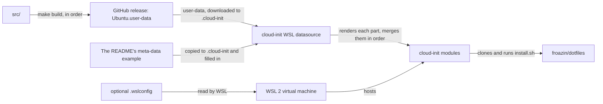

# WSL

A reusable cloud-init config that builds an Ubuntu WSL instance for development from scratch, on its first boot.

## Contents

1. [What it sets up](#what-it-sets-up)
1. [Using it](#using-it)
1. [How it works](#how-it-works)
1. [Contributing](#contributing)
1. [Licence](#licence)

## What it sets up

- The packages a zsh workstation needs, plus podman and tools such as `gh`, `ripgrep`, `fd`, `btop`, `make` and commitizen (`cz`).
- A KVM and libvirt stack for running virtual machines inside WSL.
- podman's Docker-compatible API socket: rootless for every user, and the system socket for root.
- `/etc/wsl.conf` with systemd on, and swap off, which WSL turns on by default.
- Windows tools (VS Code, the 1Password CLI, OpenSSH and `clip`) linked into the Linux `PATH`, and `$BROWSER` set so `xdg-open` opens things in Windows.
- A user with zsh and passwordless sudo, named by your meta-data's `username`, or `wsluser` when it gives none.
- For that user: `uv`, `pulumi`, Biome, `nvm`, Claude Code, the Claude Platform CLI (`ant`) and the VS Code and GitHub CLI extensions you list.
- A git config for that user, with optional commit signing.
- The [froazin/dotfiles](https://github.com/froazin/dotfiles) zsh, git, podman and Claude Code config, for the user and for root.

## Using it

You need Windows with WSL 2. cloud-init reads two files from `%USERPROFILE%\.cloud-init\`, named after the instance, `Ubuntu`:

| File | Where it comes from | What it is |
| --- | --- | --- |
| `Ubuntu.user-data` | Each [release](https://github.com/froazin/wsl/releases) | The cloud-init config. It holds nothing personal |
| `Ubuntu.meta-data` | You write it from [the meta-data example](#the-meta-data-example) | Your username, git identity and extension lists. Keep your copy to yourself |

1. Download the user-data from the latest release. From PowerShell:

   ```powershell
   $dir = "$env:USERPROFILE\.cloud-init"
   New-Item -ItemType Directory -Force $dir | Out-Null
   Invoke-WebRequest "https://github.com/froazin/wsl/releases/latest/download/Ubuntu.user-data" -OutFile "$dir\Ubuntu.user-data"
   ```

1. Copy [the meta-data example](#the-meta-data-example) into `%USERPROFILE%\.cloud-init\Ubuntu.meta-data`, and fill it in.
1. Optionally, set up `.wslconfig` as [The .wslconfig example](#the-wslconfig-example) describes.
1. Install Ubuntu under its default name, `Ubuntu`, which is the name cloud-init matches the files by:

   ```powershell
   wsl --install Ubuntu
   ```

   You can pick a specific release of Ubuntu by naming the instance `Ubuntu`, such as with `wsl --install Ubuntu-26.04 --name Ubuntu`. cloud-init runs on the first boot only, and the first launch waits for it.

1. When it finishes, restart the instance so the `wsl.conf` settings and the new group memberships take effect:

   ```powershell
   wsl --terminate Ubuntu
   ```

### The meta-data example

The meta-data holds everything personal, so the user-data stays the same for everyone. Each comment describes the value below it. Leave a value empty to skip it, and add your own extensions to the lists.

<!-- meta-data example -->

```yaml
# Needed by cloud-init. Any value will do.
instance-id: wsl

# Linux username, created with uid 1000, zsh and passwordless sudo. Leave it
# empty for wsluser.
username:

# git user.name and user.email.
git_name:
git_email:

# Public SSH key to sign commits with, such as "ssh-ed25519 AAAA...". Commit
# signing is only turned on when this is set. A literal key, rather than a key
# file path, is also written to ~/.config/git/allowed_signers, so git can
# verify your signatures. It's trusted for git_email, or for any identity when
# that's empty or has characters other than letters, digits and .+_@-.
git_signingkey:

# Program git signs with, such as 1Password's WSL helper:
# /mnt/c/Users/<you>/AppData/Local/Microsoft/WindowsApps/op-ssh-sign-wsl.exe
git_ssh_program:

# VS Code extensions to install into the instance's VS Code server, by
# Marketplace ID (publisher.name). Needs VS Code with its WSL extension on
# Windows.
vscode_extensions:
  - Anthropic.claude-code
  - ms-python.python

# GitHub CLI extensions to install, as a repository URL
# (https://github.com/owner/gh-name), host/owner/gh-name or owner/gh-name.
gh_extensions:
  - https://github.com/nektos/gh-act
```

### Reading what it runs

The user-data is a MIME multipart file of cloud-config parts, and each part is base64-encoded, so it isn't readable as text. Read it in [`src/`](src/) at the release's tag instead, such as `https://github.com/froazin/wsl/tree/<tag>/src`, with the tag from the release's page. There's one fragment per part, and they run in the order of their numbers.

### The .wslconfig example

`%USERPROFILE%\.wslconfig` holds the settings for the WSL 2 virtual machine, shared by every instance. The config works without one. This example suits a large workstation: copy it, or merge it into yours by hand.

```ini
[wsl2]
networkingMode=Mirrored

dnsTunneling=true
autoProxy=true

swap=0
defaultVhdSize=64GB

processors=12
memory=32GB
kernelCommandLine=cgroup_no_v1=all

nestedVirtualization=true

[general]
instanceIdleTimeout=-1

[experimental]
hostAddressLoopback=true
sparseVhd=true
```

- Check `processors` and `memory` fit your machine.
- `networkingMode=Mirrored` needs Windows 11 22H2 or later. Where it isn't supported, WSL falls back to no network, so remove the line.
- WSL reads the file when its virtual machine starts, so run `wsl --shutdown` after you change it.

### Building it

Build on a current Ubuntu, or in a WSL instance built from this config, so the build uses a cloud-init close to the instance's. Install the tools from apt, then run the build and the checks from the repository's root:

```sh
sudo apt-get install cloud-init make shellcheck shfmt
make build
shellcheck .github/scripts/*.sh
shfmt -d .
```

- `make build` joins every fragment in `src/`, in the order of their numbers, into `dist/Ubuntu.user-data`. It only rebuilds it when a fragment or the `Makefile` changes, and the same fragments build the same file. `make clean` deletes `dist/`. Edit `src/`, never `dist/`.
- There are no unit tests, and nothing validates the rendered user-data. [Build](docs/build.md#validation) says what `make build` does and doesn't check.
- shfmt reads its options from `.editorconfig`, so run it without formatting flags: any flag such as `-i` makes it ignore `.editorconfig`.

### Testing a change

Build the user-data with `make build`, as [Building it](#building-it) describes. Copy `dist/Ubuntu.user-data` as `Test.user-data`, and write `Test.meta-data` from [the meta-data example](#the-meta-data-example), to match a throwaway instance. Then install it, and remove it when you're done:

```powershell
wsl --install Ubuntu --name Test
wsl --unregister Test
```

WSL instances share one cgroup tree, so stop your main instance first if you're testing the user's systemd services, such as `podman.socket`. While another instance runs a systemd session for the same uid, the test instance's user session fails to start.

### Making it your own

Fork the repository and change the fragments in [`src/`](src/), then build your own user-data with `make build`, which writes it to `dist/Ubuntu.user-data`. To drop a feature, delete its fragment. To add one, add a fragment whose number puts it where it runs, as [Build](docs/build.md#the-fragments) says. The user-data clones and installs [froazin/dotfiles](https://github.com/froazin/dotfiles): point `dotfiles_repo` near the top of [`99-dotfiles.user-data`](src/99-dotfiles.user-data) at your own dotfiles, which need a `src/install.sh`, or remove the entries that run it.

## How it works

The config is plain cloud-init, written as one numbered fragment per feature. `make build` joins them, in order, into one user-data file, because WSL reads only one, and the release workflow publishes it. cloud-init's WSL datasource reads the files on the instance's first boot:



The design docs explain each part, for anyone changing it:

- [Provisioning](docs/provisioning.md): how the user-data's fragments, stages and `runcmd` work.
- [WSL meta-data](docs/meta-data.md): how each meta-data key is validated and where it ends up.
- [Build](docs/build.md): how the `Makefile` joins the fragments into `dist/Ubuntu.user-data` with cloud-init.
- [CI](docs/ci.md): the checks and the code review that run on each pull request.
- [Releases](docs/releases.md): how `main` is released, with the end-to-end test on a Windows runner.

## Contributing

Issues and pull requests are open to this repository's collaborators only, because the config runs as root on their machines. You're welcome to use the config as it is, or to fork the repository and keep your own version, as [Making it your own](#making-it-your-own) describes.

## Licence

[MIT](LICENSE).
