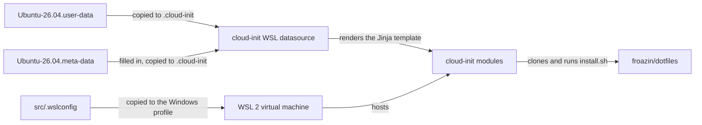

# WSL

A reusable cloud-init config that builds an Ubuntu 26.04 WSL instance for development from scratch, on its first boot.

## What it sets up

- The packages a zsh workstation needs, plus podman and tools such as `gh`, `ripgrep`, `fd` and `btop`.
- A KVM and libvirt stack for running virtual machines inside WSL.
- podman's Docker-compatible API socket: rootless for every user, and the system socket for root.
- `/etc/wsl.conf` with systemd on, and swap off to match [`.wslconfig`](src/.wslconfig).
- Windows tools (VS Code, the 1Password CLI, OpenSSH and `clip`) linked into the Linux `PATH`, and `$BROWSER` set so `xdg-open` opens things in Windows.
- A user with zsh and passwordless sudo, when you give a username.
- For that user: `uv`, `pulumi`, Biome, `nvm`, Claude Code, the Claude Platform CLI (`ant`) and the VS Code and GitHub CLI extensions you list.
- A git config for that user, with optional commit signing.
- The [froazin/dotfiles](https://github.com/froazin/dotfiles) zsh, git, podman and Claude Code config, for the user and for root.

## Using it

You need Windows with WSL 2. The config has three files:

| File | Copy to | What it is |
| --- | --- | --- |
| [`src/.wslconfig`](src/.wslconfig) | `%USERPROFILE%\.wslconfig` | Settings for the WSL 2 virtual machine, shared by every instance. Check `processors` and `memory` fit your machine |
| [`src/Ubuntu-26.04.user-data`](src/Ubuntu-26.04.user-data) | `%USERPROFILE%\.cloud-init\Ubuntu-26.04.user-data` | The cloud-init config. It holds nothing personal |
| [`src/Ubuntu-26.04.meta-data`](src/Ubuntu-26.04.meta-data) | `%USERPROFILE%\.cloud-init\Ubuntu-26.04.meta-data` | Your username, git identity and extension lists. Fill it in, and keep your copy to yourself |

1. Copy the files. From PowerShell, this downloads the two cloud-init files:

   ```powershell
   $base = 'https://raw.githubusercontent.com/froazin/wsl/main/src'
   New-Item -ItemType Directory -Force "$env:USERPROFILE\.cloud-init" | Out-Null
   foreach ($f in 'Ubuntu-26.04.user-data', 'Ubuntu-26.04.meta-data') {
       Invoke-WebRequest "$base/$f" -OutFile "$env:USERPROFILE\.cloud-init\$f"
   }
   ```

   Merge `.wslconfig` into yours by hand, if you already have one.

1. Fill in `%USERPROFILE%\.cloud-init\Ubuntu-26.04.meta-data`. Its comments describe each value, and an empty value is skipped.
1. Install the distribution under its default name, which is the name cloud-init matches the files by:

   ```powershell
   wsl --install Ubuntu-26.04
   ```

   cloud-init runs on the first boot only, and the first launch waits for it.

1. When it finishes, restart the instance so the `wsl.conf` settings and the new group memberships take effect:

   ```powershell
   wsl --terminate Ubuntu-26.04
   ```

### Without a username

If the meta-data gives no `username`, WSL asks you to create a user as normal, and that user gets zsh and the virtualisation groups. Root is already configured. Finish setting up the user yourself:

```bash
curl -LsSf https://astral.sh/uv/install.sh | env UV_NO_MODIFY_PATH=1 sh
curl -fsSL https://get.pulumi.com | sh -s -- --no-edit-path
curl -fsSL https://biomejs.dev/install | bash -s -- --no-modify-path
git clone https://github.com/nvm-sh/nvm.git ~/workspaces/github.com/nvm-sh/nvm
cd ~/workspaces/github.com/nvm-sh/nvm
git checkout "$(git describe --abbrev=0 --tags --match 'v[0-9]*' "$(git rev-list --tags --max-count=1)")"
# Installs that release into ~/.nvm. The zsh config from the dotfiles loads it, so leave the profiles alone.
PROFILE=/dev/null bash install.sh
cd
curl -fsSL https://claude.ai/install.sh | bash
v="$(curl -fsSLI -o /dev/null -w '%{url_effective}' https://github.com/anthropics/anthropic-cli/releases/latest)"; v="${v##*/v}"
case "$(uname -m)" in aarch64) a=arm64 ;; *) a=amd64 ;; esac
mkdir -p ~/.local/bin && curl -fsSL "https://github.com/anthropics/anthropic-cli/releases/download/v$v/ant_${v}_linux_$a.tar.gz" | tar -xzmf - -C ~/.local/bin ant
# The extensions in your meta-data's vscode_extensions, for example:
code --install-extension Anthropic.claude-code --install-extension ms-python.python
# The extensions in your meta-data's gh_extensions, for example:
gh extension install https://github.com/nektos/gh-act
git clone https://github.com/froazin/dotfiles.git ~/workspaces/github.com/froazin/dotfiles
# Until the ~/.zshenv from the dotfiles exists, the installer can't see tools in ~/.local/bin.
PATH="$HOME/.local/bin:$HOME/.pulumi/bin:$PATH" sh ~/workspaces/github.com/froazin/dotfiles/src/install.sh
```

### Testing a change

Copy the files as `ci-test.user-data` and `ci-test.meta-data` to match a throwaway instance, then install it and remove it when you're done:

```powershell
wsl --install Ubuntu-26.04 --name ci-test
wsl --unregister ci-test
```

WSL instances share one cgroup tree, so stop your main instance first if you're testing the user's systemd services, such as `podman.socket`. While another instance runs a systemd session for the same uid, the test instance's user session fails to start.

### Making it your own

Fork the repository and change your copy. The user-data clones and installs [froazin/dotfiles](https://github.com/froazin/dotfiles): point `dotfiles_repo` near the top of [`Ubuntu-26.04.user-data`](src/Ubuntu-26.04.user-data) at your own dotfiles, which need a `src/install.sh`, or remove the entries that run it.

## How it works

The config is plain cloud-init. You copy the files into your Windows profile, and cloud-init's WSL datasource reads them on the instance's first boot:



The design docs explain each part, for anyone changing it:

- [Provisioning](docs/provisioning.md): how `.wslconfig` and the user-data's stages and `runcmd` work, and how the user-data is validated.
- [WSL meta-data](docs/meta-data.md): how each meta-data key is validated and where it ends up.
- [CI](docs/ci.md): the checks, the end-to-end tests on Windows runners and the code review that run on each pull request.

## Contributing

Issues and pull requests are open to this repository's collaborators only, because the config runs as root on their machines. You're welcome to use the config as it is, or to fork the repository and keep your own version. See [CONTRIBUTING.md](CONTRIBUTING.md).

## Licence

[MIT](LICENSE).
