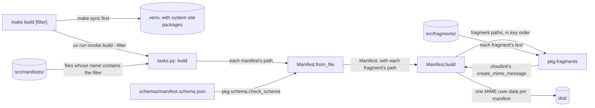

# Build

How the [`Makefile`](../Makefile), [`tasks.py`](../tasks.py) and the Python package in [`pkg/`](../pkg/) build the cloud-init fragments in [`src/`](../src/) into the files users download. It's for engineers changing a fragment, a task or the tooling. What a manifest holds is in [Distros and manifests](distros.md), the commands to run are in [CONTRIBUTING.md](../CONTRIBUTING.md#checks), and what the user-data does on an instance is in [Provisioning](provisioning.md).

## Contents

1. [Overview](#overview)
1. [The source layout](#the-source-layout)
1. [How the build works](#how-the-build-works)
1. [Validation](#validation)
1. [Errors](#errors)
1. [Tool configuration](#tool-configuration)
1. [Decisions](#decisions)
1. [Limits](#limits)
1. [Sources](#sources)

## Overview

The tooling has three layers:

- **Environment:** the `Makefile` creates `.venv` and runs the task. `make build [filter]` runs `make sync`, then `uv run invoke build`.
- **Task:** `tasks.py` defines the Invoke task `build`. It finds the manifests, calls `pkg/` and turns a `BuildError` into an exit status.
- **Logic:** [`pkg/manifest.py`](../pkg/manifest.py) loads a manifest and writes its user-data, [`pkg/schema.py`](../pkg/schema.py) checks a manifest against the schema and [`pkg/fragments.py`](../pkg/fragments.py) joins the fragments. None of them imports Invoke.

This flowchart shows how `make build` turns the manifests into `dist/`:



## The source layout

```text
src/
├── fragments/
│   ├── base.user-data             merge_how, locale, apt update and upgrade
│   ├── windows.user-data          Windows tool links, $BROWSER and the start script
│   ├── ...
│   └── dotfiles.user-data         the dotfiles installs, for the user and root
└── manifests/
    └── ubuntu-26.04.yml           the fragments in dist/Ubuntu-26.04.user-data
```

- Each fragment is a cloud-config named `<feature>.user-data`, and becomes one part of a manifest's MIME user-data. The manifest's keys set its place in the merge, and so the order of `runcmd`.
- A fragment that reads meta-data starts with `## template: jinja` on its first line, then `#cloud-config`.
- Every fragment keeps the same `merge_how`: `list(append)` and `dict(no_replace, recurse_list)`. [How the build works](#how-the-build-works) says why.
- Edit `src/`, never `dist/`. Git ignores `dist/`.

## How the build works

`invoke build` takes every `*.yml` or `*.yaml` file in `src/manifests/`, in name order. With `--filter`, it keeps only the files whose name contains the filter, ignoring case. `make build ubuntu` passes `ubuntu` as the filter. WSL finds a user-data by name without regard to case, so two of the files kept whose names differ only in case or extension, such as `Ubuntu.yml` and `ubuntu.yaml`, are an error, and so are two whose `name` differs only in case, because they'd write the same user-data. For each file, it:

1. Loads the manifest with `Manifest.from_file`, which checks it against the schema and turns each fragment's name into `src/fragments/<name>.user-data`, in key order. [Distros and manifests](distros.md) describes the file.
1. Calls `Manifest.build`, which passes the paths to `create_mime_message_from_paths` in `pkg/fragments.py`. That checks every fragment exists, then reads each one, makes it a `jinja2` part when it starts with `## template: jinja` and a `cloud-config` part otherwise, and names the part after its file, such as `base.user-data`.
1. Joins the parts with `create_mime_message`, from `cloudinit.cmd.devel.make_mime`, the function behind `cloud-init devel make-mime`, and writes the result to `dist/<name>.user-data`, where `<name>` is the manifest's `name`.

Nothing else is built: users write the meta-data from the README's example. What follows from the fragments being separate parts:

- **One file for WSL.** cloud-init's WSL datasource reads exactly one user-data file, so it can't read a folder of parts. A MIME multipart file holds them all, and cloud-init splits it at boot.
- **Part order and `merge_how`.** cloud-init walks the parts in the order they appear in the MIME file (`walk()` in `cloudinit/handlers/__init__.py`), which is the manifest's key order. Without a `merge_how` that appends, a fragment's `packages`, `write_files` or `runcmd` would replace the earlier fragments' lists. Keep order-dependent entries in the right fragment: the global `podman.socket` enable is in `podman`, before the first `runuser -l` in `development`, as [Provisioning](provisioning.md#runcmd) explains.
- **Jinja per part.** cloud-init renders each Jinja part on its own, with the instance's meta-data, before it merges them. A fragment can't see another fragment's variables or macros, so each sets every variable it uses, such as `user`, and `development` and `dotfiles` each define the `workspace` macro.
- **Base64 parts.** Each part is base64-encoded, so the built user-data isn't readable as text. Read the fragments in `src/` instead.
- **A random boundary.** `create_mime_message` picks a new MIME boundary each time, so two builds of the same parts differ byte for byte.

## Validation

There is no validation yet. The old `invoke validate` task, which merged the user-data for each mock meta-data case with cloud-init's part handlers and checked the result, was removed with the old build, and will be rebuilt for the YAML manifests. Until then, `make build` only proves that every manifest matches the schema and that every fragment it lists exists.

## Errors

- `pkg/` raises [`BuildError`](../pkg/errors.py) for a failure the user can fix: a manifest that can't be read, isn't valid YAML, doesn't match the schema or lists a fragment twice, or a fragment that doesn't exist. `tasks.py` raises it too for no manifests to build, or two with the same file name or `name`, ignoring case. The schema error lists every problem with where it is, such as `- $.version: ...`. `tasks.py` turns it into an `Exit` with status 1, so Invoke prints the message without a traceback.
- `tasks.py` exits with status 1 itself when the schema or `src/manifests/` is missing.
- Any other exception is a bug, and keeps its traceback.

## Tool configuration

- **Python:** the system Python 3.14. [`pyproject.toml`](../pyproject.toml) sets `python-preference = "only-system"` and `python-downloads = "never"`, so uv never fetches its own Python. `package = false`: nothing is installed, and Invoke finds `pkg` from the repository root.
- **System site packages:** `make venv` creates `.venv` with `uv venv --system-site-packages`, from the first of `/usr/libexec/platform-python`, `/usr/bin/python3` and `/usr/bin/python`. `pkg/` imports `cloudinit`, `jsonschema` and `yaml` from the system's `cloud-init` package and its dependencies, so the build uses the same cloud-init as the distro. uv has no setting or environment variable for this, so the flag only takes effect when the venv is created, and `make venv` does nothing when `.venv` exists.
- **Pyright:** [`pyrightconfig.json`](../pyrightconfig.json) sets `standard` mode for Python 3.14, adds `pkg` to `extraPaths` and names no venv. Under `uv run`, Pyright uses the venv's Python with its system site packages.
- **Ruff:** `[tool.ruff]` in `pyproject.toml`, with a 120-character line. `src = [".", "pkg"]` makes it sort `pkg`'s modules as first-party imports.
- **pytest:** collects from `tests/`, with `pkg` on the import path. There are no unit tests yet.
- **Dependencies:** every dependency that isn't from the system is in the `dev` group. `exclude-newer = "7 days"` resolves only versions at least 7 days old. `uv.lock` is ignored by Git.
- **Shell:** shfmt reads its options from [`.editorconfig`](../.editorconfig), which also keeps the `Makefile` indented with tabs.

## Decisions

- **Real cloud-init parts, joined by cloud-init.** Each fragment is a cloud-config that cloud-init itself merges, rather than a template a custom builder fills in. The manifests only choose which fragments to join, and in what order.
- **cloud-init's Python package over its command line.** Calling `create_mime_message` gives the same output as `cloud-init devel make-mime` (observed, apart from the boundary) without running a command for each manifest or staging the fragments in a folder to name the parts.
- **Order from the manifest, not file names.** The manifest's keys set the order, so a fragment's name only says what it does, and the same fragment can sit at a different place in another manifest.
- **Paths resolved when a manifest loads.** `Manifest.from_file` turns names into paths, so `Manifest.build` and `pkg/fragments.py` only read the paths they're given.
- **Thin tasks.** The logic is in `pkg/`, where it can be used without Invoke.

## Limits

- A fragment can't share a variable or macro with another, so shared code, such as `user` and `workspace`, is repeated.
- Nothing checks the user-data until validation is rebuilt, and the end-to-end tests in [Releases](releases.md) haven't been brought up to date with this build.
- The filter matches the manifest's file name, not its `name`, because it picks the files before any is read. A broken manifest, or two that clash, stop the build only when the filter keeps them.
- A clash is reported without naming the files, which is enough for a handful of manifests.
- The build doesn't empty `dist/` first, so a manifest that's been renamed or removed leaves its old user-data there.

## Sources

- https://cloudinit.readthedocs.io/en/latest/explanation/format.html
- https://cloudinit.readthedocs.io/en/latest/reference/merging.html
- https://cloudinit.readthedocs.io/en/latest/reference/datasources/wsl.html
