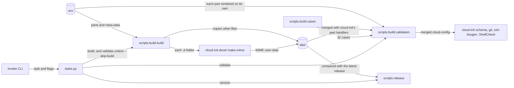

# Build and validation

How `tasks.py` and the Python packages in [`scripts/`](../scripts/) build the cloud-init parts in [`src/`](../src/) into the files users download, and how the build is checked. It's for engineers changing the parts, a task or the tooling. The commands to run are in [CONTRIBUTING.md](../CONTRIBUTING.md#checks), and what the user-data does on an instance is in [Provisioning](provisioning.md).

## Contents

1. [Overview](#overview)
1. [The source layout](#the-source-layout)
1. [How the build works](#how-the-build-works)
1. [Validation](#validation)
1. [Errors](#errors)
1. [Unit tests](#unit-tests)
1. [Tool configuration](#tool-configuration)
1. [Decisions](#decisions)
1. [Limits](#limits)
1. [Sources](#sources)

## Overview

The tooling has two layers:

- **Tasks:** [`tasks.py`](../tasks.py) defines the Invoke tasks `build`, `validate` and `version`. Each is a thin wrapper that calls a package in `scripts/` and turns its error into an exit status.
- **Logic:** [`scripts/build/`](../scripts/build/) builds and validates the config, and [`scripts/release/`](../scripts/release/) works out the next release's version, as [Releases](releases.md) describes. Neither imports Invoke.

This flowchart shows what each task calls, and the files and tools it uses:



## The source layout

```text
src/
├── Ubuntu-26.04.meta-data           copied to dist/ as it is
└── Ubuntu-26.04.user-data.d/
    ├── 00-base.user-data            merge_how, locale, apt update and upgrade
    ├── 10-windows.user-data         Windows tool links, $BROWSER and the start script
    ├── ...
    └── 99-dotfiles.user-data        the dotfiles installs, for the user and root
```

- Each part is a cloud-config named `NN-<feature>.user-data`. The number sets its place in the merge, and so the order of `runcmd`.
- A part that reads meta-data starts with `## template: jinja` on its first line, then `#cloud-config`.
- Every part keeps the same `merge_how`: `list(append)` and `dict(no_replace, recurse_list)`. [How the build works](#how-the-build-works) says why.
- Edit `src/`, never `dist/`. `dist/` is ignored by Git, and every build empties it.

## How the build works

`invoke build` calls `build()` in [`build.py`](../scripts/build/build.py). It empties `dist/`, then for each entry in `src/`, in name order:

- A folder named `<name>.d` becomes `dist/<name>`, a MIME multipart file of the folder's parts. `build.py` runs `cloud-init devel make-mime` from inside the folder, attaching each file by name, so each part is named by its file name. A part is `jinja2` when its first line is `## template: jinja`, and `cloud-config` otherwise.
- Any other file is copied as it is.
- Anything else, such as a folder without the `.d` suffix, is a `BuildError`.

What follows from the parts being separate:

- **One file for WSL.** cloud-init's WSL datasource reads exactly one user-data file, so it can't read a folder of parts. A MIME multipart file holds them all, and cloud-init splits it at boot.
- **Part order and `merge_how`.** cloud-init merges the parts in the order they appear in the MIME file, which is name order. Without a `merge_how` that appends, a part's `packages`, `write_files` or `runcmd` would replace the earlier parts' lists. Keep order-dependent entries in the right part: the global `podman.socket` enable is in `40-podman`, before the first `runuser -l` in `90-development`, as [Provisioning](provisioning.md#runcmd) explains.
- **Jinja per part.** cloud-init renders each Jinja part on its own, with the instance's meta-data, before it merges them. A part can't see another part's variables or macros, so each sets every variable it uses, such as `user`, and `90-development` and `99-dotfiles` each define the `workspace` macro.
- **Base64 parts.** make-mime base64-encodes each part, so the built user-data isn't readable as text. Read the parts in `src/` instead.
- **A random boundary.** make-mime picks a new MIME boundary each time, so two builds of the same parts differ byte for byte. The release workflow compares the parts, not the bytes (see [Releases](releases.md#how-the-version-is-decided)).

## Validation

`invoke validate` builds `dist/` first, unless `--skip-build` is given, then calls `validate()` in [`validation.py`](../scripts/build/validation.py). It needs `cloud-init`, `git`, `shellcheck` and `ssh-keygen`, and makes throwaway ed25519 and ECDSA keys for the signing cases.

For each case in [`cases.py`](../scripts/build/cases.py), it:

1. Merges `dist/Ubuntu-26.04.user-data` with cloud-init's own part handlers (`UserDataProcessor`, `CloudConfigPartHandler` and `JinjaTemplatePartHandler`), with the case's meta-data as instance-data. That's what cloud-init does at boot. `cloud-init devel render` can't read a MIME file.
1. Checks the merged cloud-config: no undefined Jinja variable, `cloud-init schema -c` passes and it starts with `#cloud-config`.
1. Renders each part in `src/` on its own, and checks it renders and is valid YAML. Then it checks the merged config lists every part, and that its `packages`, `write_files` and `runcmd` are every part's entries appended in name order. A part that lost its `merge_how` fails here.
1. Checks the case's expectations: the user, the workspace directory, the extensions installed and skipped, the `podman.socket` order, root's dotfiles install and that `runcmd` can be written as UTF-8.
1. Checks what git reads back from `.gitconfig`, and that `allowed_signers` works with `ssh-keygen` as git uses it.

After the cases, it runs ShellCheck on `/usr/local/bin/start` from the `full` case, then checks every file in `src/` and `dist/`, with the MIME parts decoded, for a concrete `/mnt/c/Users/<name>/` path, and every Jinja part in `src/` for a `{%` or `{#` tag that starts a line away from column 0.

It prints `ok   <case>` or `FAIL <case>` for each case, after a `FAIL: <case>: <problem>` line for each problem. It ends with `All cases passed.`, or raises a `BuildError`. The cases and what each proves are in the [validate-user-data skill](../.claude/skills/validate-user-data/SKILL.md). Add a case for every new meta-data key or conditional, including the key being unset.

## Errors

- `scripts.build` raises [`BuildError`](../scripts/build/errors.py), and `scripts.release` raises [`ReleaseError`](../scripts/release/errors.py), for a failure the user can fix. `tasks.py` turns each into an `Exit` with status 1, so Invoke prints the message without a traceback.
- `BuildError` covers a parts folder with no parts, an entry in `src/` that's neither a file nor a `.d` folder, a missing command, a missing file in `dist/` and a failed validation.
- A failed `make-mime` raises Invoke's `UnexpectedExit` from `c.run`, which Invoke reports without a traceback (inferred).
- Any other exception is a bug, and keeps its traceback.
- cloud-init's own warnings for a part that fails, such as "Failed loading yaml blob", go to standard error beside the `FAIL:` lines.

## Unit tests

- Tests live in `scripts/<package>/test/`, without an `__init__.py`. `testpaths = ["scripts"]`, so pytest collects only those. `tasks.py` has no tests: it holds no logic.
- `norecursedirs` is pytest's default list without `build`, which would otherwise skip `scripts/build/`.
- `--import-mode=importlib` imports each test file by path, so test files in different packages can share a name.
- The build and validation tests run no external commands. The version tests build test dists with the real `make-mime`, and one runs semantic-release with a bad option.

## Tool configuration

- **Python:** the system Python 3.14. [`pyproject.toml`](../pyproject.toml) sets `python-preference = "only-system"` and `python-downloads = "never"`, so uv never fetches its own Python. `package = false`: nothing is installed, and Invoke and pytest find `scripts` from the repository root.
- **System site packages:** create `.venv` with `uv venv --system-site-packages`. The validation imports `cloudinit` and `yaml` from apt's `cloud-init` and `python3-yaml`, so it uses the same cloud-init as Ubuntu 26.04.
- **Pyright:** [`pyrightconfig.json`](../pyrightconfig.json) sets `standard` mode for Python 3.14, and names no venv. Under `uv run`, Pyright uses the venv's Python with its system site packages. With `venvPath` set it couldn't import `cloudinit` (observed).
- **Ruff:** `[tool.ruff]` in `pyproject.toml`, with a 120-character line.
- **Dependencies:** every Python dependency is in the `dev` group. `exclude-newer = "7 days"` resolves only versions at least 7 days old. `uv.lock` is ignored by Git.
- **Shell:** shfmt reads its options from [`.editorconfig`](../.editorconfig).

## Decisions

- **Real cloud-init parts, joined by cloud-init.** Each part is a cloud-config that cloud-init itself merges, rather than a template a custom builder fills in. `make-mime` is cloud-init's own tool for this.
- **Validate the merge as cloud-init does it.** The validation calls cloud-init's part handlers rather than merging the YAML itself, so it can't disagree with an instance about the result.
- **Thin tasks.** The logic is in `scripts/`, where it can be tested without Invoke.

## Limits

- A part can't share a variable or macro with another, so shared code, such as `user` and `workspace`, is repeated.
- The validation doesn't prove a real first boot. The end-to-end tests in [Releases](releases.md#end-to-end-tests) install an instance on Windows runners.
- Each case runs cloud-init's merge and `cloud-init schema`, so `invoke validate` takes several minutes.

## Sources

- https://cloudinit.readthedocs.io/en/latest/explanation/format.html
- https://cloudinit.readthedocs.io/en/latest/reference/merging.html
- https://cloudinit.readthedocs.io/en/latest/reference/datasources/wsl.html
