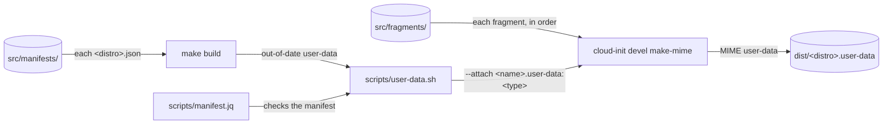

# Build

How the [`Makefile`](../Makefile) and the scripts in [`scripts/`](../scripts/) build the cloud-init fragments in [`src/`](../src/) into the files users download. It's for engineers changing a fragment, the `Makefile` or the scripts. What a manifest holds is in [Distros and manifests](distros.md), the commands to run are in [CONTRIBUTING.md](../CONTRIBUTING.md#checks), and what the user-data does on an instance is in [Provisioning](provisioning.md).

## Contents

1. [Overview](#overview)
1. [The source layout](#the-source-layout)
1. [How the build works](#how-the-build-works)
1. [Validation](#validation)
1. [Errors](#errors)
1. [Tools](#tools)
1. [Decisions](#decisions)
1. [Limits](#limits)
1. [Sources](#sources)

## Overview

The build needs three tools from apt, and no Python of its own:

- **make** finds the manifests and runs the build for each one whose user-data is out of date.
- **jq** reads the manifests. [`scripts/manifest.jq`](../scripts/manifest.jq) checks each one, and [`scripts/version.jq`](../scripts/version.jq) reads their version.
- **cloud-init**'s `cloud-init devel make-mime` joins a manifest's fragments into one MIME multipart user-data.

[`scripts/user-data.sh`](../scripts/user-data.sh) builds one user-data. This flowchart shows how `make build` turns the manifests into `dist/`:



## The source layout

```text
src/
├── fragments/
│   ├── base.user-data             merge_how, locale, apt update and upgrade
│   ├── windows.user-data          Windows tool links, $BROWSER and the start script
│   ├── ...
│   └── dotfiles.user-data         the dotfiles installs, for the user and root
└── manifests/
    └── Ubuntu-26.04.json          the fragments in dist/Ubuntu-26.04.user-data
```

- Each fragment is a cloud-config named `<feature>.user-data`, and becomes one part of a manifest's MIME user-data. Its place in the manifest's list sets its place in the merge, and so the order of `runcmd`.
- A fragment that reads meta-data starts with `## template: jinja` on its first line, then `#cloud-config`.
- Every fragment keeps the same `merge_how`: `list(append)` and `dict(no_replace, recurse_list)`. [How the build works](#how-the-build-works) says why.
- Edit `src/`, never `dist/`. Git ignores `dist/`.

## How the build works

The `Makefile` takes every `*.json` file in `src/manifests/`, and makes `dist/<distro>.user-data` for each, where `<distro>` is the file's name without `.json`. Each user-data depends on its manifest, every fragment and the two scripts, so make rebuilds it when any of them changes, and `make build` does nothing when it's up to date. Before it builds anything, it stops when there are no manifests, or when two names differ only in case, because WSL finds a user-data by name without regard to case.

For each user-data that's out of date, make runs `scripts/user-data.sh <manifest> <output>`, which:

1. Checks the file's name is a WSL distribution name: letters, digits, `.`, `_` and `-`, starting with a letter or digit.
1. Checks the manifest with `jq --slurp -f scripts/manifest.jq`, which prints a line for each rule it breaks. [Distros and manifests](distros.md#checking-a-manifest) lists them.
1. Checks every fragment it lists exists as `src/fragments/<name>.user-data`.
1. Passes each fragment, in the manifest's order, to `cloud-init devel make-mime` as `--attach <name>.user-data:<type>`. The type is `jinja2` when the fragment's first line is `## template: jinja`, and `cloud-config` otherwise. make-mime names each part after the path it's given, so the script runs it in `src/fragments/`, and the parts are named after their files, such as `base.user-data`.
1. Writes make-mime's output to a temporary file, then moves it to `dist/<distro>.user-data`, so a failed build leaves no partial file.

Nothing else is built: users write the meta-data from the README's example. What follows from the fragments being separate parts:

- **One file for WSL.** cloud-init's WSL datasource reads exactly one user-data file, so it can't read a folder of parts. A MIME multipart file holds them all, and cloud-init splits it at boot.
- **Part order and `merge_how`.** cloud-init walks the parts in the order they appear in the MIME file (`walk()` in `cloudinit/handlers/__init__.py`), which is the manifest's order. Without a `merge_how` that appends, a fragment's `packages`, `write_files` or `runcmd` would replace the earlier fragments' lists. Keep order-dependent entries in the right fragment: the global `podman.socket` enable is in `podman`, before the first `runuser -l` in `development`, as [Provisioning](provisioning.md#runcmd) explains.
- **Jinja per part.** cloud-init renders each Jinja part on its own, with the instance's meta-data, before it merges them. A fragment can't see another fragment's variables or macros, so each sets every variable it uses, such as `user`, and `development` and `dotfiles` each define the `workspace` macro.
- **Base64 parts.** Each part is base64-encoded, so the built user-data isn't readable as text. Read the fragments in `src/` instead.
- **A random boundary.** make-mime picks a new MIME boundary each time, so two builds of the same parts differ byte for byte.

`make version` runs [`scripts/version.jq`](../scripts/version.jq) on every manifest. It prints the version they share, and fails when one has no version string or they differ. [Releases](releases.md#how-the-version-is-decided) describes how the release workflow uses it. `make clean` deletes `dist/`.

## Validation

Nothing validates the built user-data. `make build` only proves that every manifest keeps the rules in `scripts/manifest.jq`, that every name is unique, ignoring case, and that every fragment a manifest lists exists. Nothing renders the Jinja, merges the parts or runs `cloud-init schema`. The code review checks those by reading, and the [end-to-end tests](releases.md#end-to-end-tests) install the user-data on a first boot before each release.

## Errors

- make stops before it builds anything when there are no manifests, or two whose names match, ignoring case. `make clean` skips these checks, so it runs whatever state the manifests are in.
- `scripts/user-data.sh` stops at the first of its checks that fails, with a message that starts with the manifest's path, and writes no user-data for it. A user-data from an earlier build stays in `dist/` until `make clean`. In order, it fails when:
  - jq or cloud-init isn't installed.
  - The file's name isn't a WSL distribution name.
  - The manifest isn't valid JSON. jq's own error comes first.
  - The manifest breaks rules in `scripts/manifest.jq`, with one line for each rule it breaks.
  - Fragments it lists don't exist, with one line for each.
  - make-mime fails.
- `make version` fails with jq's error, which names the manifest, when one has no version string or the versions differ.
- make exits with status 2 when a recipe fails.

## Tools

- **cloud-init:** from apt, on Ubuntu 26.04, so the build uses the same make-mime as the instance. It doesn't need root.
- **jq:** from apt. `scripts/manifest.jq` uses `test`, so it needs a jq with regular expressions, which Ubuntu's has.
- **Shell:** `scripts/user-data.sh` is POSIX `sh`. ShellCheck lints it, and shfmt reads its options from [`.editorconfig`](../.editorconfig), which also keeps the `Makefile` indented with tabs.
- **No tests:** the project has no unit tests. The checks in [CONTRIBUTING.md](../CONTRIBUTING.md#checks) are the build, the version check and the shell lint.

## Decisions

- **Real cloud-init parts, joined by cloud-init.** Each fragment is a cloud-config that cloud-init itself merges, rather than a template a custom builder fills in. The manifests only choose which fragments to join, and in what order.
- **cloud-init's command line, not a Python build.** `cloud-init devel make-mime` gives the same parts as calling its Python function (observed: the same names, content types and payloads), with no venv, Python dependencies or Python checks to keep up. The cost is a `cd` into `src/fragments/` to name the parts.
- **JSON manifests, checked with jq.** jq reads JSON with no other tool, where YAML would need `yq`, and Ubuntu's `yq` package is itself a Python wrapper around jq. jq has no JSON Schema validator, so `scripts/manifest.jq` repeats the schema's rules the build relies on, and the schema itself is for editors.
- **The file's name is the distro's name.** make can then map `src/manifests/<distro>.json` to `dist/<distro>.user-data` with a pattern rule, and rebuild only what's out of date.
- **Order from the manifest, not file names.** The order of the manifest's list sets the merge order, so a fragment's name only says what it does, and the same fragment can sit at a different place in another manifest.
- **Logic in `scripts/`, not the `Makefile`.** Building a user-data is in `scripts/user-data.sh`, where ShellCheck and shfmt can check it, and the version check is in `scripts/version.jq`. The `Makefile` keeps only the case-clash check, which has to run before make picks its targets, and one-command recipes.

## Limits

- A fragment can't share a variable or macro with another, so shared code, such as `user` and `workspace`, is repeated.
- Nothing checks the rendered user-data until the end-to-end tests in [Releases](releases.md) run, and they run only when a release is due.
- `scripts/manifest.jq` and `schemas/manifest.schema.json` state the same rules twice, so a change to one has to be made to the other.
- Every fragment is a prerequisite of every user-data, so a change to one fragment rebuilds them all, even those that don't list it.
- There's no filter: `make build` builds every manifest, and `make dist/<distro>.user-data` builds one.
- make splits file names at spaces, so a manifest whose name has a space fails with a confusing error before the name check runs.
- `make build` doesn't delete the user-data of a manifest that's been renamed or removed. `make clean` does.

## Sources

- https://cloudinit.readthedocs.io/en/latest/explanation/format.html
- https://cloudinit.readthedocs.io/en/latest/reference/cli.html#devel
- https://cloudinit.readthedocs.io/en/latest/reference/merging.html
- https://cloudinit.readthedocs.io/en/latest/reference/datasources/wsl.html
- https://jqlang.org/manual/
- https://www.gnu.org/software/make/manual/make.html#Pattern-Rules
