# Build

How the [`Makefile`](../Makefile) joins the cloud-init fragments in [`src/fragments/`](../src/fragments/) into the user-data users download. It's for engineers adding, changing or reordering a fragment, or changing the `Makefile`. The commands to run are in [CONTRIBUTING.md](../CONTRIBUTING.md#checks), and what the user-data does on an instance is in [Provisioning](provisioning.md).

## Contents

1. [Overview](#overview)
1. [The fragments](#the-fragments)
1. [How the build works](#how-the-build-works)
1. [Validation](#validation)
1. [Errors](#errors)
1. [Tools](#tools)
1. [Decisions](#decisions)
1. [Limits](#limits)
1. [Sources](#sources)

## Overview

`make build` passes every fragment, in file name order, to `cloud-init devel make-mime`, which joins them into one MIME multipart file, `dist/Ubuntu.user-data`. It needs make and cloud-init from apt. This flowchart shows it:

```mermaid
flowchart LR
    accTitle: How make build turns the fragments into the user-data
    accDescr: make build passes every fragment in src/fragments, in file name order, to cloud-init devel make-mime as a jinja2 or cloud-config part. sed replaces make-mime's random MIME boundary with a fixed one, and the result is dist/Ubuntu.user-data.
    fragments[("src/fragments/")] -->|"#lt;NN#gt;-#lt;feature#gt;.user-data, in name order"| make["make build"]
    make -->|"--attach file:jinja2 or cloud-config"| mime["cloud-init devel make-mime"]
    mime -->|"random boundary"| sed["sed: fixed boundary"]
    sed -->|"same fragments, same file"| dist[("dist/Ubuntu.user-data")]
```



## The fragments

```text
src/fragments/
├── 00-base.user-data             merge_how, locale, apt update and upgrade
├── 10-windows.user-data          Windows tool links, $BROWSER and the start script
├── ...
└── 99-dotfiles.user-data         the dotfiles installs, for the user and root
```

- Each fragment is a cloud-config named `<NN>-<feature>.user-data`, where `<NN>` is two digits, and becomes one part of the user-data. The number sets its place in the merge, and so the order of `runcmd`. The numbers have gaps, so a fragment can go between two others without renaming the rest.
- A fragment that reads meta-data starts with `## template: jinja` on its first line, then `#cloud-config`.
- Every fragment keeps the same `merge_how`: `list(append)` and `dict(no_replace, recurse_list)`. [How the build works](#how-the-build-works) says why.
- Edit `src/fragments/`, never `dist/`. Git ignores `dist/`.

## How the build works

The `Makefile` takes every `*.user-data` file in `src/fragments/`, sorted by name, so the two-digit numbers set the order. `dist/Ubuntu.user-data` depends on every fragment, on the `src/fragments/` folder and on the `Makefile`. The folder's time changes when a fragment is added, removed or renamed, so make rebuilds the user-data after any of those, after a change to a fragment or the `Makefile`, and `make build` does nothing when it's up to date. To build it, make:

1. Passes each fragment to `cloud-init devel make-mime` as `--attach <file>:<type>`. The type is `jinja2` when the fragment's first line is `## template: jinja`, and `cloud-config` otherwise. make-mime names each part after the path it's given, so it runs in `src/fragments/`, and the parts are named after their files, such as `00-base.user-data`.
1. Replaces make-mime's MIME boundary with a fixed one, `==============wsl-user-data==`, with `sed`. make-mime picks a random boundary on every build, so without this, two builds of the same fragments would differ. With it, they're byte for byte the same (observed), and the release workflow can compare SHA-1 hashes, as [Releases](releases.md#when-a-release-is-due) describes. Every part is base64, so the fixed boundary can't appear inside one.
1. Writes the result to `dist/Ubuntu.user-data`. The recipe deletes the old user-data first, and its temporary file when a step fails, and `.DELETE_ON_ERROR` deletes a half-written user-data, so a failed build leaves no user-data and no temporary file.

`make clean` deletes `dist/`. Nothing else is built: users write the meta-data from the README's example. What follows from the fragments being separate parts:

- **One file for WSL.** cloud-init's WSL datasource reads exactly one user-data file, so it can't read a folder of parts. A MIME multipart file holds them all, and cloud-init splits it at boot.
- **Part order and `merge_how`.** cloud-init walks the parts in the order they appear in the MIME file (`walk()` in `cloudinit/handlers/__init__.py`), which is the fragments' name order. Without a `merge_how` that appends, a fragment's `packages`, `write_files` or `runcmd` would replace the earlier fragments' lists. Keep order-dependent entries in the right fragment: the global `podman.socket` enable is in `40-podman`, before the first `runuser -l` in `90-development`, as [Provisioning](provisioning.md#runcmd) explains.
- **Jinja per part.** cloud-init renders each Jinja part on its own, with the instance's meta-data, before it merges them. A fragment can't see another fragment's variables or macros, so each sets every variable it uses, such as `user`, and `90-development` and `99-dotfiles` each define the `workspace` macro.
- **Base64 parts.** Each part is base64-encoded, so the built user-data isn't readable as text. Read the fragments in `src/fragments/` instead.

## Validation

Nothing validates the built user-data. `make build` only proves that make-mime can join the fragments. Nothing renders the Jinja, merges the parts or runs `cloud-init schema`. The code review checks those by reading, and the [end-to-end tests](releases.md#end-to-end-tests) install the user-data on a first boot before each release.

## Errors

- make stops before it builds anything when `src/fragments/` has no fragments. `make clean` skips that check.
- A failure in make-mime or `sed`, such as when cloud-init isn't installed, stops make with the command's error, and leaves no `dist/Ubuntu.user-data`, not even one from an earlier build.
- make exits with status 2 when a recipe fails.

## Tools

- **cloud-init:** from apt, on a current Ubuntu, like the instance. It doesn't need root.
- **make and sed:** from apt. The `Makefile` uses GNU make's functions and `sed -E`.
- **Shell:** shfmt reads its options from [`.editorconfig`](../.editorconfig), which also keeps the `Makefile` indented with tabs.
- **No tests:** the project has no unit tests. The checks in [CONTRIBUTING.md](../CONTRIBUTING.md#checks) are the build and the shell lint.

## Decisions

- **Real cloud-init parts, joined by cloud-init.** Each fragment is a cloud-config that cloud-init itself merges, rather than a template a custom builder fills in.
- **A part's type from its first line.** A fragment is a `jinja2` part only when its first line is exactly `## template: jinja`, so an empty first line makes a `cloud-config` part.
- **Order from the file names.** The two-digit numbers set the order, so there's no list of fragments to keep in step with the folder: a fragment is in the user-data because it's in `src/fragments/`.
- **One user-data, for Ubuntu.** The config targets Ubuntu, so there's one file, named `Ubuntu.user-data` after the instance `wsl --install Ubuntu` makes, rather than one per release of Ubuntu.
- **cloud-init's command line, not a Python build.** `cloud-init devel make-mime` gives the same parts as calling its Python function (observed: the same content types and payloads), with no Python tooling to keep up. The cost is a `cd` into `src/fragments/` to name the parts.
- **A fixed boundary.** It makes the build reproducible, so whether a release is due is decided by comparing hashes, rather than by a version someone bumps.

## Limits

- A fragment can't share a variable or macro with another, so shared code, such as `user` and `workspace`, is repeated.
- Nothing checks the rendered user-data until the end-to-end tests in [Releases](releases.md) run, and they run only when a release is due.
- Every fragment is in the user-data. To drop a feature, delete its fragment.
- make splits file names at spaces, so a fragment whose name has a space breaks the build.
- The hashes only match when the same make-mime builds the user-data. A cloud-init update that changes make-mime's output makes a release with no change to the fragments.

## Sources

- https://cloudinit.readthedocs.io/en/latest/explanation/format.html
- https://cloudinit.readthedocs.io/en/latest/reference/cli.html#devel
- https://cloudinit.readthedocs.io/en/latest/reference/merging.html
- https://cloudinit.readthedocs.io/en/latest/reference/datasources/wsl.html
- https://www.gnu.org/software/make/manual/make.html#Errors
