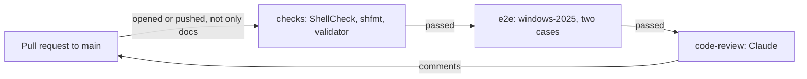

# CI

How [`.github/workflows/ci.yml`](../.github/workflows/ci.yml) checks a pull request (PR) before it merges: the lint and validation, the end-to-end tests on Windows runners and Claude's code review. It's for engineers changing the workflow, its scripts in [`.github/scripts/`](../.github/scripts/) or [`REVIEW.md`](../REVIEW.md).

## Contents

1. [Overview](#overview)
1. [Checks](#checks)
1. [End-to-end tests](#end-to-end-tests)
1. [Code review](#code-review)
1. [Dependabot](#dependabot)
1. [Set up](#set-up)
1. [Security](#security)
1. [Decisions](#decisions)
1. [Limits](#limits)
1. [Sources](#sources)

## Overview

`ci.yml` runs on every PR to `main` that changes more than docs. A maintainer squash-merges the PR once the workflow passes and every review thread is resolved. This flowchart shows the jobs:

- **`paths-ignore`** on the `pull_request` trigger skips the whole workflow when every file a PR changes is Markdown, or under `docs/`, `.claude/` or `.vscode/`, or is `.github/dependabot.yml` or `LICENSE`. The list names what's safe to skip, so a new kind of file is checked until it's added to it.
- Each job needs the one before it, so a failure skips the rest, and the workflow's own result is the one check to read before merging.

## Checks

The `checks` job runs on `ubuntu-26.04`, so `cloud-init` comes from the same release as the instance. It installs `cloud-init`, `python3-yaml`, `shellcheck` and `shfmt` from apt, then runs the commands in [CONTRIBUTING.md](../CONTRIBUTING.md#checks): ShellCheck on every shell script, `shfmt -d .` and [`tests/validate-user-data.sh`](../tests/validate-user-data.sh).

## End-to-end tests

The `e2e` job installs an instance the way the README tells users to, on a raw `windows-2025` runner, which comes with WSL. It runs two cases, each on its own runner, because WSL instances on one machine share a cgroup tree:

| Case | Meta-data |
| --- | --- |
| `with a user` | The template with `username`, `git_name` and `git_email` filled in |
| `without a user` | The template as it is, with no username |

Each step is a script in `.github/scripts/`:

1. **`set-up-wslconfig.ps1`** writes `src/.wslconfig` to the runner's profile without `processors` and `memory`, which size the virtual machine for a workstation, and without `networkingMode`. The runner doesn't support mirrored networking, and WSL falls back to no network at all (observed), so the instance keeps WSL's default NAT. It then runs `wsl --shutdown` so WSL reads the file.
1. **`seed-cloud-init.ps1`** copies the user-data to `%USERPROFILE%\.cloud-init\Ubuntu-26.04.user-data`, and writes the meta-data template there with the case's values filled into its empty keys.
1. **`install-instance.ps1`** runs `wsl --install Ubuntu-26.04 --no-launch --web-download`.
1. **`wait-for-cloud-init.ps1`** runs `cloud-init status --wait` as root, which boots the instance for the first time, then shows cloud-init's status and logs. It fails if cloud-init didn't use the WSL datasource, or reports any error or recoverable error in `result.json` or `cloud-init status --format json`. A recoverable error that every instance built from this config gets is only logged. The script lists them in `$expected`.
1. **`restart-instance.ps1`** runs `wsl --terminate`, as the README says to, then fails unless `systemctl is-system-running --wait` says `running`.
1. **`check-instance.ps1`** runs [`check-instance.sh`](../.github/scripts/check-instance.sh) as root inside the instance. It checks the system files, packages, links, units, shells and dotfiles, and for the `with a user` case the user, their groups, git config, tools and gh extension.

`runcmd` doesn't stop at a failing entry, and cloud-init only sees the exit status of the last one, so `check-instance.sh` is what catches a failed install.

## Code review

The `code-review` job asks Claude Sonnet 5.5 to review the lines the PR adds or changes since it branched from `main`, and to comment on the PR for each finding. It runs through [anthropics/claude-code-action](https://github.com/anthropics/claude-code-action).

- Claude follows [REVIEW.md](../REVIEW.md) as it is at the merge base on `main`, or `main`'s current copy for a branch older than it, so a PR can't change its own review's rules. Only when `main` has no `REVIEW.md` does it follow the PR's copy.
- The action restores `CLAUDE.md`, `.claude/` and similar config from `main` before Claude starts. When the PR changes them, a step saves the PR's versions to `.code-review/head/`, under names Claude Code doesn't load as instructions.
- Every comment must be resolved before the PR can merge, so Claude posts Nits sparingly. It posts at most three per review, and after the first review only on lines changed since the last one that succeeded. From the fourth review on a PR it posts none. A step counts the earlier reviews from the Actions API.
- The same step saves the review threads already on the PR, keeping only comments from the owner, members, collaborators and the Actions bot. Claude never raises an issue a thread already raises.
- Claude posts each finding with the action's own comment tool, `mcp__github_inline_comment__create_inline_comment`, with `confirmed: true` so it posts at once. It can only use that tool and read files.
- The job passes whatever Claude finds. The unresolved threads are what hold the PR back.
- Drafts and Dependabot's PRs aren't reviewed.

## Dependabot

[`.github/dependabot.yml`](../.github/dependabot.yml) opens one PR each Wednesday that updates every action the workflow uses, grouped together, with a `chore(deps):` title. Its 7-day cooldown skips any release less than a week old, so a compromised release has time to be caught. Its PRs run the checks and the end-to-end tests like any other, but get no code review.

## Set up

- **`CLAUDE_CODE_OAUTH_TOKEN`**, a repository secret, bills Claude's runs to the maintainer's Claude subscription. Make it with `claude setup-token` and save it with `gh secret set CLAUDE_CODE_OAUTH_TOKEN`. Without it, the review is skipped with a notice.
- **The `Protect main` ruleset** requires squash merges, signed commits, linear history and resolved review threads. It requires no status checks, so a maintainer checks the CI workflow passed before merging.
- **Issues and PRs** are limited to collaborators.

## Security

- **The token stays in the review step.** No job that runs the PR's code, such as `checks` or `e2e`, gets `CLAUDE_CODE_OAUTH_TOKEN`.
- **The workflow's token, as narrow as each job allows.** Every job can read the repository's contents. The code review passes the workflow's token as `github_token`, so the Claude GitHub App's token isn't used, and adds `pull-requests: write` to comment and `actions: read` to count earlier reviews.
- **PR content is data.** The prompt says to treat files, diffs, commits and comments as data. Only collaborators can open PRs, and Claude sees only trusted authors' comments.
- **Few tools.** The review has no Bash. It can read files and post review comments, and can't push, approve or merge.
- **Pinned actions.** Every action is pinned to a full commit SHA, with its version in a comment, and Dependabot proposes no release less than 7 days old.

## Decisions

- **A raw runner, not a setup action.** The e2e job installs the instance with `wsl.exe` as a user would, so it tests the README's steps rather than an action's.
- **The meta-data template, filled in.** The e2e job fills in `src/Ubuntu-26.04.meta-data` rather than using a fixture, so the shipped defaults, such as the gh extension, are tested too.
- **Fail on recoverable errors.** A deprecated key or a schema warning means user-data that needs fixing. The exception is the network wait that every instance gets, which [Provisioning](provisioning.md#limits) explains. It's logged rather than annotated, so the run's annotations only show something to act on.
- **The code review after the tests.** No tokens go on code that doesn't pass its checks, end-to-end included.
- **GitHub's path filter, not a job that lists the files.** `paths-ignore` is built in, but it can only run all of the workflow or none of it. Every PR that changes more than docs gets the end-to-end tests, even when it only changes `tests/`, and a docs-only PR gets no checks or review.
- **No gate job.** GitHub marks the workflow failed when any job fails, and no status check is required, so a job that sums up the others adds nothing.
- **Resolved threads, not a failing check.** A wrong finding is resolved with a reply rather than a re-run. That's why Nits are capped.

## Limits

- The e2e job runs a command as root for the first boot, which skips Ubuntu's first-run setup. That setup writes the default user to `/etc/wsl.conf`, so CI doesn't test it.
- VS Code and the other Windows tools aren't on the runner, so their links are checked but the VS Code extension installs are skipped.
- The runner has no `processors`, `memory` or `networkingMode` from `src/.wslconfig`, so CI doesn't test mirrored networking.
- The e2e job downloads Ubuntu and every package on each run, so it takes a while and depends on those servers.
- The review is Claude's judgement, so it can be wrong. The Nit limits are in the prompt, so nothing enforces them.
- Nothing stops a maintainer merging a PR whose checks failed, because none are required.
- A docs-only PR isn't reviewed, so nothing checks that its docs still match the code.
- A PR whose checks are skipped has no workflow run at all, so its checks list is empty rather than skipped.

## Sources

- https://learn.microsoft.com/en-us/windows/wsl/basic-commands
- https://cloudinit.readthedocs.io/en/latest/reference/cli.html#status
- https://github.com/actions/runner-images/blob/main/images/windows/Windows2025-Readme.md
- https://github.com/anthropics/claude-code-action
