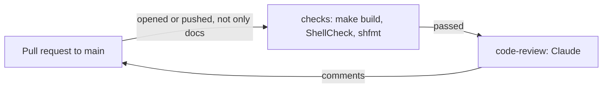

# CI

How [`.github/workflows/ci.yml`](../.github/workflows/ci.yml) checks a pull request (PR) before it merges: the build and the shell lint, and Claude's code review. It's for engineers changing the workflow or [`REVIEW.md`](../REVIEW.md). The end-to-end tests on Windows runners run on `main` before a release, as [Releases](releases.md) describes.

## Contents

1. [Overview](#overview)
1. [Checks](#checks)
1. [Code review](#code-review)
1. [Set up](#set-up)
1. [Security](#security)
1. [Decisions](#decisions)
1. [Limits](#limits)
1. [Sources](#sources)

## Overview

`ci.yml` runs on every PR to `main` that changes more than docs. A maintainer squash-merges the PR once the workflow passes and every review thread is resolved. This flowchart shows the jobs:

- **`paths`** on the `pull_request` trigger skips the whole workflow when every file a PR changes is Markdown other than `README.md`, a file under `docs/`, `.claude/` or `.vscode/` or another file that can't change the config, such as `LICENSE`. `README.md` isn't skipped, because the [end-to-end tests](releases.md#end-to-end-tests) read its meta-data example. The list starts with `**`, every file, and each later `!` pattern skips what it matches, unless a later pattern takes it back, as `README.md` does after `!**.md`. The list names what's safe to skip, so a new kind of file is checked until it's added to it. The release workflow uses the same list.
- `code-review` needs `checks`, so a failure skips the review, and the workflow's own result is the one check to read before merging.

## Checks

The `checks` job runs on `ubuntu-26.04`, so `cloud-init` comes from a current release of Ubuntu. It installs `cloud-init`, `make`, `shellcheck` and `shfmt` from apt (see [Build](build.md#tools)). Then it runs the commands in [CONTRIBUTING.md](../CONTRIBUTING.md#checks): `make build`, ShellCheck on `.github/scripts/*.sh` and `shfmt -d .`.

`make build` only joins the fragments. Nothing renders the user-data or runs `cloud-init schema` on it, so the code review checks those by reading, and the end-to-end tests catch what it misses before a release.

## Code review

The `code-review` job asks Claude Sonnet 5.5 to review the lines the PR adds or changes since it branched from `main`, and to comment on the PR for each finding. It runs through [anthropics/claude-code-action](https://github.com/anthropics/claude-code-action).

- Claude follows [REVIEW.md](../REVIEW.md) as it is at the merge base on `main`, or `main`'s current copy for a branch older than it, so a PR can't change its own review's rules. Only when `main` has no `REVIEW.md` does it follow the PR's copy.
- The action restores `CLAUDE.md`, `.claude/` and similar config from `main` before Claude starts. When the PR changes them, a step saves the PR's versions to `.code-review/head/`, under names Claude Code doesn't load as instructions.
- Every comment must be resolved before the PR can merge, so Claude posts Nits sparingly. It posts at most three per review, and after the first review only on lines changed since the last one that succeeded. From the fourth review on a PR it posts none. A step counts the earlier reviews from the Actions API.
- The same step saves the review threads already on the PR, keeping only comments from the owner, members, collaborators and the Actions bot. Claude never raises an issue a thread already raises.
- Claude posts each finding with the action's own comment tool, `mcp__github_inline_comment__create_inline_comment`, with `confirmed: true` so it posts at once. It can only use that tool and read files.
- The job passes whatever Claude finds. The unresolved threads are what hold the PR back.
- Drafts aren't reviewed until they're ready.

## Set up

- **`CLAUDE_CODE_OAUTH_TOKEN`**, a repository secret, bills Claude's runs to the maintainer's Claude subscription. Make it with `claude setup-token` and save it with `gh secret set CLAUDE_CODE_OAUTH_TOKEN`. Without it, the review is skipped with a notice.
- **The `Protect main` ruleset** requires squash merges, signed commits, linear history and resolved review threads. It requires no status checks, so a maintainer checks the CI workflow passed before merging.
- **Issues and PRs** are limited to collaborators.

## Security

- **The token stays in the review step.** The `checks` job, which runs the PR's code, doesn't get `CLAUDE_CODE_OAUTH_TOKEN`.
- **The workflow's token, as narrow as each job allows.** Every job can read the repository's contents. The code review passes the workflow's token as `github_token`, so the Claude GitHub App's token isn't used, and adds `pull-requests: write` to comment and `actions: read` to count earlier reviews.
- **PR content is data.** The prompt says to treat files, diffs, commits and comments as data. Only collaborators can open PRs, and Claude sees only trusted authors' comments.
- **Few tools.** The review has no Bash. It can read files and post review comments, and can't push, approve or merge.
- **Pinned actions.** Every action is pinned to a full commit SHA, with its version in a comment.

## Decisions

- **No end-to-end tests on a PR.** They take a long time on Windows runners, so they run on `main` before a release instead (see [Releases](releases.md#decisions)).
- **The code review after the checks.** No tokens go on code that doesn't pass its checks.
- **GitHub's path filter, not a job that lists the files.** `paths` is built in, but it can only run all of the workflow or none of it. A docs-only PR gets no checks or review. It's `paths` rather than `paths-ignore`, because only `paths` can take back one file, `README.md`, from a pattern that skips it.
- **No gate job.** GitHub marks the workflow failed when any job fails, and no status check is required, so a job that sums up the others adds nothing.
- **Resolved threads, not a failing check.** A wrong finding is resolved with a reply rather than a re-run. That's why Nits are capped.

## Limits

- A PR is never installed on a real instance before it merges. A change that breaks a first boot is caught on `main`, where it blocks releases until a fix lands (see [Releases](releases.md#limits)).
- The review is Claude's judgement, so it can be wrong. The Nit limits are in the prompt, so nothing enforces them.
- Nothing stops a maintainer merging a PR whose checks failed, because none are required.
- A docs-only PR isn't reviewed, so nothing checks that its docs still match the code.
- A PR whose checks are skipped has no workflow run at all, so its checks list is empty rather than skipped.
- Nothing renders the user-data on a PR, so a change that fails `cloud-init schema` or a first boot is first caught by the end-to-end tests on `main`, and only when it changes the built user-data.

## Sources

- https://github.com/anthropics/claude-code-action
- https://docs.github.com/en/actions/writing-workflows/workflow-syntax-for-github-actions#onpushpull_requestpull_request_targetpathspaths-ignore
