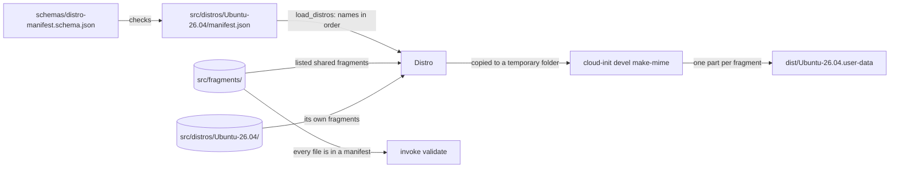

# Distros and manifests

How each distro's `manifest.json` picks the fragments its user-data is built from, and how to add a distro or a fragment only one distro needs. It's for engineers adding a distro or changing a manifest, the schema or [`scripts/build/manifest.py`](../scripts/build/manifest.py). How the fragments are joined is in [Build and validation](build.md), and what they set up is in [Provisioning](provisioning.md).

## Contents

1. [Overview](#overview)
1. [The manifest](#the-manifest)
1. [Finding the fragments](#finding-the-fragments)
1. [Shared or distro fragments](#shared-or-distro-fragments)
1. [Add a distro](#add-a-distro)
1. [Decisions](#decisions)
1. [Limits](#limits)
1. [Sources](#sources)

## Overview

```text
src/
├── fragments/                   shared fragments, which any manifest can list
│   ├── 00-base.user-data
│   ├── ...
│   └── 99-dotfiles.user-data
└── distros/
    └── Ubuntu-26.04/            named after the WSL distribution
        └── manifest.json        the fragments in its user-data
```

Each folder in `src/distros/` is one distro. The build writes `dist/<distro>.user-data` for each, and every release publishes them all. Every distro reads the same meta-data keys, from the same [meta-data example](../README.md#the-meta-data-example), so setting one up works the same way whichever it is. This flowchart shows how a distro's fragments reach its user-data:



## The manifest

[`schemas/distro-manifest.schema.json`](../schemas/distro-manifest.schema.json) describes `manifest.json`, and VS Code checks each manifest against it through `json.schemas` in [`.vscode/settings.json`](../.vscode/settings.json). It has one field:

| Field | Type | Rules |
| --- | --- | --- |
| `fragments` | Array of strings | Required. At least one, with no duplicates. Each is a fragment's file name without `.user-data`, as two digits, `-` and lowercase words joined by `-`, such as `40-podman` |

- The schema sets `"additionalProperties": false`, so a misspelt field fails rather than being ignored.
- The folder's name is the distro's name, so the manifest has no `name` field. It must be the name `wsl --install` gives the instance, such as `Ubuntu-26.04`, because the WSL datasource finds `<instance>.user-data` by it. `load_distros` accepts letters, digits, `.`, `_` and `-`, starting with a letter or digit.
- List every fragment, shared or the distro's own, in name order. That's the order cloud-init merges them in, so the manifest reads in the order `runcmd` runs.

## Finding the fragments

`load_distros()` in [`manifest.py`](../scripts/build/manifest.py) reads every manifest before the build empties `dist/`, so a broken manifest leaves the last build in place. For each distro it:

1. Checks the folder's name, then the manifest against the schema, and reports every schema error at once.
1. Checks the fragments are listed in name order.
1. Finds each fragment as `<name>.user-data` in the distro's own folder or in `src/fragments/`. A fragment in both, or in neither, is an error, so a distro's fragment never quietly replaces a shared one.
1. Rejects any file in the distro's folder that the manifest doesn't list, so a fragment can't be left out by mistake.

It also rejects a file directly in `src/distros/`, such as a manifest saved as `src/distros/<distro>.json`, because only a folder is a distro.

It raises a `BuildError` for the first distro that's wrong. `invoke validate` also fails when a file in `src/fragments/` isn't in any manifest, because nothing would build it.

## Shared or distro fragments

A fragment goes in `src/fragments/` unless what it says is only right for one distro. Keep distro fragments few: a copy of a shared fragment with one line changed is two fragments to keep in step.

- **Shared:** anything that's right for every distro that lists it, such as the WSL settings, the Windows links, the dotfiles install and the meta-data handling. A distro that doesn't need a shared fragment leaves it out of its manifest.
- **Distro:** what only one distro needs, such as a package name or an apt source that differs. Number it to slot in where it runs among the shared ones, such as `45-<feature>.user-data`, and give it a number no shared fragment uses.
- **Split before you copy.** When most of a shared fragment suits a new distro, move the part that differs into a fragment of its own, shared or per distro, rather than copying the whole fragment.

Every fragment follows the same rules, wherever it lives: it keeps the shared `merge_how`, and sets every Jinja variable it uses, as [How the build works](build.md#how-the-build-works) says. Today every fragment is shared, and `Ubuntu-26.04` lists them all.

## Add a distro

1. Check that the distribution's WSL image runs cloud-init with its WSL datasource on first boot, and find its name in `wsl --list --online`.
1. Create `src/distros/<distro>/manifest.json`, listing the shared fragments that suit it.
1. Add a fragment of its own for anything that differs, as [Shared or distro fragments](#shared-or-distro-fragments) says.
1. Run `uv run invoke validate`, which checks every case against every distro.
1. Add the distro to the README's [supported distros](../README.md#supported-distros), and to `check-instance.sh` if it sets up something different.

The release workflow's end-to-end tests install every distro in `dist/` (see [End-to-end tests](releases.md#end-to-end-tests)).

## Decisions

- **One explicit list per distro.** The manifest names every fragment, so it says in one place what a distro gets. A list of exclusions from the shared fragments would hide that.
- **No overrides.** A distro's fragment can't share a name with a shared one. Replacing a shared fragment by name would make a change to it skip that distro without saying so.
- **Name order, checked.** The fragments' numbers already set the merge order, so the build doesn't take another order from the manifest. It checks the manifest agrees.
- **Distro differences in fragments, not build-time templates.** The fragments are already Jinja that cloud-init renders at boot. A second layer of templating at build time would use the same `{{ }}` syntax in the same files.
- **JSON with a schema, like the devcontainers images.** The schema gives editors and the build the same rules. With one field, a dataclass loads it without the checks that keep a larger dataclass and schema in step.
- **The folder names the distro.** The name has to match the instance and the file name, so a separate field could only disagree with them.

## Limits

- The validation renders every distro with the same instance-data: `v1.distro` is `ubuntu` and `v1.distro_version` is `26.04` for all of them. A fragment that reads `v1` gets Ubuntu's values in the cases.
- `invoke validate` runs `cloud-init schema` with the checks job's cloud-init, from Ubuntu 26.04, for every distro. Another distro may ship a different cloud-init.
- `check-instance.sh` checks the same things in every distro.
- `jsonschema` comes from apt's `python3-jsonschema`, which `cloud-init` installs, through the venv's system site packages, so the schema's errors are worded as that version words them (4.19.2 on Ubuntu 26.04, observed).

## Sources

- https://cloudinit.readthedocs.io/en/latest/reference/datasources/wsl.html
- https://json-schema.org/draft/2020-12
- https://learn.microsoft.com/en-us/windows/wsl/basic-commands
