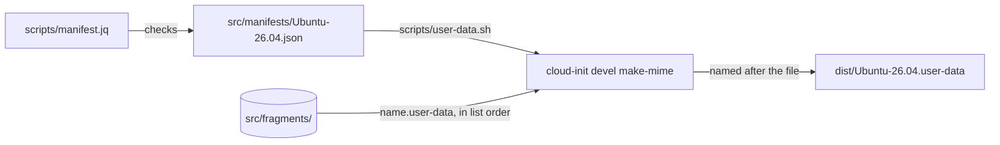

# Distros and manifests

How each distro's manifest in `src/manifests/` picks the fragments its user-data is built from, and how to add a distro or a fragment only one distro needs. It's for engineers adding a distro or changing a manifest, the schema or [`scripts/manifest.jq`](../scripts/manifest.jq). How the fragments are joined is in [Build](build.md), and what they set up is in [Provisioning](provisioning.md).

## Contents

1. [Overview](#overview)
1. [The manifest](#the-manifest)
1. [Checking a manifest](#checking-a-manifest)
1. [Shared or distro fragments](#shared-or-distro-fragments)
1. [Add a distro](#add-a-distro)
1. [Decisions](#decisions)
1. [Limits](#limits)
1. [Sources](#sources)

## Overview

```text
src/
├── fragments/                   every fragment, which any manifest can list
│   ├── base.user-data
│   ├── ...
│   └── dotfiles.user-data
└── manifests/
    └── Ubuntu-26.04.json        one distro: its version and its fragments, in order
```

Each file in `src/manifests/` is one distro, named after it. The build writes `dist/<distro>.user-data` for each. Every distro reads the same meta-data keys, from the same [meta-data example](../README.md#the-meta-data-example), so setting one up works the same way whichever it is. This flowchart shows how a manifest becomes a distro's user-data:



## The manifest

A manifest is JSON, named after the distro, such as `Ubuntu-26.04.json`. [`schemas/manifest.schema.json`](../schemas/manifest.schema.json) describes it, and VS Code checks each `src/manifests/*.json` against it through `json.schemas` in [`.vscode/settings.json`](../.vscode/settings.json).

```json
{
  "version": "0.0.1",
  "description": "The cloud-init user-data for a development instance of Ubuntu 26.04 LTS on WSL.",
  "fragments": ["base", "windows", "utilities"]
}
```

| Field | Type | Rules |
| --- | --- | --- |
| `version` | String | Required. A Semantic Versioning 2.0.0 version without a `v`, such as `0.0.1`. It's the version of the release the user-data is published in, so every manifest has the same one. [Releases](releases.md#how-the-version-is-decided) says when to bump it, and which part |
| `description` | String | Required, and not empty |
| `fragments` | List | Required, with at least one entry. Each entry is a fragment's file name without `.user-data`, in lowercase words joined by `-`, starting with a letter, such as `github-cli`. The list's order is the order cloud-init merges them in. List each fragment once |

- The file's name is the name `wsl --install` gives the instance, such as `Ubuntu-26.04`, because the WSL datasource finds `<instance>.user-data` by it. It's letters, digits, `.`, `_` and `-`, starting with a letter or digit.
- The schema sets `"additionalProperties": false`, so a misspelt field fails rather than being ignored.

## Checking a manifest

`scripts/user-data.sh` checks the file's name, then runs [`manifest.jq`](../scripts/manifest.jq) on the manifest with `jq --slurp`. It prints one line for each rule the manifest breaks, so the build reports every problem at once:

- The file holds one JSON object.
- It has `version`, `description` and `fragments`, and no other field.
- `version` matches the schema's Semantic Versioning pattern. The patterns end with `\z`, because jq's `$` also matches before a final newline, where the schema's doesn't.
- `description` is a string that isn't empty.
- `fragments` is a list of at least one fragment name, each listed once.

The script then checks every fragment exists. These are the schema's rules, written again in jq, because jq can't read a JSON Schema. Keep the two in step.

## Shared or distro fragments

Every fragment lives in `src/fragments/`, and each manifest lists the ones it gets. Share a fragment unless what it says is only right for one distro. Keep distro-only fragments few: a copy of a shared fragment with one line changed is two fragments to keep in step.

- **Shared:** anything that's right for every distro that lists it, such as the WSL settings, the Windows links, the dotfiles install and the meta-data handling. A distro that doesn't need a shared fragment leaves it out of its manifest.
- **Distro only:** what only one distro needs, such as a package name or an apt source that differs. Only that distro's manifest lists it, at the place in the list where it runs among the shared ones.
- **Split before you copy.** When most of a shared fragment suits a new distro, move the part that differs into a fragment of its own rather than copying the whole fragment.

Every fragment follows the same rules: it keeps the shared `merge_how`, and sets every Jinja variable it uses, as [How the build works](build.md#how-the-build-works) says. Today `Ubuntu-26.04.json` lists every fragment.

## Add a distro

1. Check that the distribution's WSL image runs cloud-init with its WSL datasource on first boot, and find its name in `wsl --list --online`.
1. Create `src/manifests/<distro>.json`, named after the distro, with its `description` and the shared fragments that suit it. Give it the same `version` as the other manifests, and bump them all, as a new feature.
1. Add a fragment of its own for anything that differs, as [Shared or distro fragments](#shared-or-distro-fragments) says.
1. Run `make build` and check that `dist/<distro>.user-data` is written.
1. Add the distro to the README's [supported distros](../README.md#supported-distros), and to `check-instance.sh` if it sets up something different.

## Decisions

- **One explicit list per distro.** The manifest names every fragment, so it says in one place what a distro gets. A list of exclusions from the shared fragments would hide that.
- **Order in the manifest.** The list sets the merge order, so a fragment's file name only says what it does, and each distro can place a fragment where it needs it.
- **One folder of fragments.** A distro's fragment can't take the name of a shared one, because they share a folder. Replacing a shared fragment by name would make a change to it skip that distro without saying so.
- **Distro differences in fragments, not build-time templates.** The fragments are already Jinja that cloud-init renders at boot. A second layer of templating at build time would use the same `{{ }}` syntax in the same files.
- **JSON with a schema.** jq reads JSON directly, and the schema gives editors the same rules `manifest.jq` checks in the build. [Build](build.md#decisions) says why not YAML.
- **The distro's name in the file's name.** make maps each manifest to its user-data by name, so a `name` field would be a second copy that could disagree.

## Limits

- Nothing checks that every file in `src/fragments/` is in a manifest.
- The schema and `manifest.jq` state the same rules twice, and nothing checks they agree.
- `check-instance.sh` checks the same things in every distro.

## Sources

- https://cloudinit.readthedocs.io/en/latest/reference/datasources/wsl.html
- https://json-schema.org/draft/2020-12
- https://jqlang.org/manual/
- https://learn.microsoft.com/en-us/windows/wsl/basic-commands
