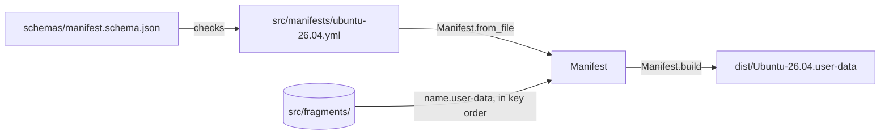

# Distros and manifests

How each distro's manifest in `src/manifests/` picks the fragments its user-data is built from, and how to add a distro or a fragment only one distro needs. It's for engineers adding a distro or changing a manifest, the schema or [`pkg/manifest.py`](../pkg/manifest.py). How the fragments are joined is in [Build](build.md), and what they set up is in [Provisioning](provisioning.md).

## Contents

1. [Overview](#overview)
1. [The manifest](#the-manifest)
1. [Loading a manifest](#loading-a-manifest)
1. [Shared or distro fragments](#shared-or-distro-fragments)
1. [Add a distro](#add-a-distro)
1. [Decisions](#decisions)
1. [Limits](#limits)
1. [Sources](#sources)

## Overview

```text
src/
├── fragments/                   every fragment, which any manifest can list
│   ├── base.user-data
│   ├── ...
│   └── dotfiles.user-data
└── manifests/
    └── ubuntu-26.04.yml         one distro: its name and its fragments, in order
```

Each file in `src/manifests/` is one distro. The build writes `dist/<name>.user-data` for each. Every distro reads the same meta-data keys, from the same [meta-data example](../README.md#the-meta-data-example), so setting one up works the same way whichever it is. This flowchart shows how a manifest becomes a distro's user-data:



## The manifest

A manifest is YAML. [`schemas/manifest.schema.json`](../schemas/manifest.schema.json) describes it, and VS Code checks each `src/manifests/*.yml` and `*.yaml` against it through `yaml.schemas` in [`.vscode/settings.json`](../.vscode/settings.json).

```yaml
name: Ubuntu-26.04
version: 0.0.1
description: The cloud-init user-data for a development instance of Ubuntu 26.04 LTS on WSL.
fragments:
  0: base
  1: windows
  2: utilities
```

| Field | Type | Rules |
| --- | --- | --- |
| `name` | String | Required. The name `wsl --install` gives the instance, such as `Ubuntu-26.04`, because the WSL datasource finds `<instance>.user-data` by it. Letters, digits, `.`, `_` and `-`, starting with a letter or digit |
| `version` | String | Required. A Semantic Versioning 2.0.0 version without a `v`, such as `0.0.1`. It's the version of the release the user-data is published in, so every manifest has the same one. [Releases](releases.md#how-the-version-is-decided) says when to bump it, and which part |
| `description` | String | Required, and not empty |
| `fragments` | Mapping | Required, with at least one entry. Each key is a whole number with no leading zero, and sets the fragment's place in the merge. Each value is a fragment's file name without `.user-data`, in lowercase words joined by `-`, starting with a letter, such as `github-cli` |

- The schema sets `"additionalProperties": false`, so a misspelt field fails rather than being ignored.
- The keys can have gaps, such as `10`, `20` and `30`, so a fragment can be slotted in later without renumbering the rest.
- Name the file after the distro in lowercase, such as `ubuntu-26.04.yml`. `make build <filter>` matches the file name, not `name`.

## Loading a manifest

`Manifest.from_file` in [`manifest.py`](../pkg/manifest.py) reads one manifest:

1. Parses the file with PyYAML's `safe_load`.
1. Checks it against the schema with `check_schema` in [`schema.py`](../pkg/schema.py), which reports every schema error at once. PyYAML reads a key such as `0:` as a number, and `jsonschema` only checks the pattern of a string key, so `check_schema` checks a copy with the keys turned into strings. Without that, a key such as `-1` would pass.
1. Checks it lists each fragment once.
1. Turns each fragment's name into `<fragments_dir>/<name>.user-data`, and sorts them by key.

It raises a `BuildError` when the file can't be read, isn't valid YAML, doesn't match the schema or lists a fragment twice. It doesn't check that each fragment exists: `Manifest.build` checks that before it reads any.

## Shared or distro fragments

Every fragment lives in `src/fragments/`, and each manifest lists the ones it gets. Share a fragment unless what it says is only right for one distro. Keep distro-only fragments few: a copy of a shared fragment with one line changed is two fragments to keep in step.

- **Shared:** anything that's right for every distro that lists it, such as the WSL settings, the Windows links, the dotfiles install and the meta-data handling. A distro that doesn't need a shared fragment leaves it out of its manifest.
- **Distro only:** what only one distro needs, such as a package name or an apt source that differs. Only that distro's manifest lists it, with a key that puts it where it runs among the shared ones.
- **Split before you copy.** When most of a shared fragment suits a new distro, move the part that differs into a fragment of its own rather than copying the whole fragment.

Every fragment follows the same rules: it keeps the shared `merge_how`, and sets every Jinja variable it uses, as [How the build works](build.md#how-the-build-works) says. Today `ubuntu-26.04.yml` lists every fragment.

## Add a distro

1. Check that the distribution's WSL image runs cloud-init with its WSL datasource on first boot, and find its name in `wsl --list --online`.
1. Create `src/manifests/<distro>.yml`, with its `name` and `description`, and the shared fragments that suit it. Give it the same `version` as the other manifests, and bump them all, as a new feature.
1. Add a fragment of its own for anything that differs, as [Shared or distro fragments](#shared-or-distro-fragments) says.
1. Run `make build <distro>` and check that `dist/<name>.user-data` is written.
1. Add the distro to the README's [supported distros](../README.md#supported-distros), and to `check-instance.sh` if it sets up something different.

## Decisions

- **One explicit list per distro.** The manifest names every fragment, so it says in one place what a distro gets. A list of exclusions from the shared fragments would hide that.
- **Order in the manifest.** The keys set the merge order, so a fragment's file name only says what it does, and each distro can place a fragment where it needs it.
- **One folder of fragments.** A distro's fragment can't take the name of a shared one, because they share a folder. Replacing a shared fragment by name would make a change to it skip that distro without saying so.
- **Distro differences in fragments, not build-time templates.** The fragments are already Jinja that cloud-init renders at boot. A second layer of templating at build time would use the same `{{ }}` syntax in the same files.
- **YAML with a schema.** The schema gives editors and the build the same rules, and YAML matches the cloud-config the fragments are written in.
- **`name` in the file.** The manifest names the distro and its output, so the file's own name only has to find it.

## Limits

- Nothing checks that every file in `src/fragments/` is in a manifest.
- File names and `name`s are only compared among the manifests the filter keeps, ignoring case, so `make build ubuntu` doesn't notice a clash between two other manifests.
- `check-instance.sh` checks the same things in every distro.

## Sources

- https://cloudinit.readthedocs.io/en/latest/reference/datasources/wsl.html
- https://json-schema.org/draft/2020-12
- https://learn.microsoft.com/en-us/windows/wsl/basic-commands
