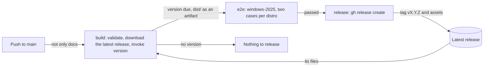

# Releases

How [`.github/workflows/release.yml`](../.github/workflows/release.yml) releases the config from `main`: how it decides whether a release is due and its version, the end-to-end tests on Windows runners and the tags and assets it publishes. It's for engineers changing the workflow or the end-to-end scripts in [`.github/scripts/`](../.github/scripts/).

> [!WARNING]
> Releases haven't been rebuilt for the new build yet. `release.yml` still runs `uv run invoke validate` and `uv run invoke version`, and the `version` task, `scripts/release/` and the semantic-release settings in `pyproject.toml` were removed with the old build, so the workflow's `build` job fails until releases are rebuilt. This doc describes the old release process.

## Contents

1. [Overview](#overview)
1. [How the version is decided](#how-the-version-is-decided)
1. [Tags and assets](#tags-and-assets)
1. [End-to-end tests](#end-to-end-tests)
1. [Security](#security)
1. [Decisions](#decisions)
1. [Limits](#limits)
1. [Sources](#sources)

## Overview

The workflow runs on every push to `main`, with the same `paths` filter as [CI](ci.md#overview), so a docs-only push runs nothing. Runs share the `release` concurrency group: a run waits for the one in progress, and a newer push replaces a run that's still waiting, so two releases never race. The `release` job only publishes when its commit is still the head of `main`, because a newer push's run releases the same changes. This flowchart shows the jobs:

- **`build`** checks out the whole history and its tags, sets up the tools as the CI `checks` job does and runs `uv run invoke validate`. It lists the distros in `dist/` for the `e2e` matrix, then downloads the latest release's files with `gh release download`, when a release exists, then runs `uv run invoke version`. When that prints a version, it uploads `dist/` as the `dist` artifact.
- **`e2e`** runs only when a version is due. See [End-to-end tests](#end-to-end-tests).
- **`release`** needs both, so a failed build or end-to-end test skips it. It downloads the artifact and runs `gh release create "v$VERSION" dist/* --target "$GITHUB_SHA" --generate-notes`.

## How the version is decided

`invoke version --previous <dir>` calls `next_version()` in `scripts/release/version.py`. It prints the version, or nothing when no release is due.

1. **Is a release due?** It compares `dist/` with the latest release's files. The file names must match. A MIME user-data matches when its parts' file names, content types and decoded payloads do, because make-mime picks a random boundary on every build (see [Build and validation](build.md#how-the-build-works)). Any other file must match byte for byte. When they all match, no release is due, whatever the commits say.
1. **What version?** It runs semantic-release with `version --print-last-released` (empty before the first release, read as `0.0.0`) and `version --print`.
1. **A forced patch.** When `--print` gives the last version again, because no commit calls for a bump, such as a `refactor`, it runs `version --print --patch`. What users download still changed, so it's still a release.

semantic-release reads its settings from `[tool.semantic_release]` in [`pyproject.toml`](../pyproject.toml):

- **Only `src/` counts.** The `conventional-monorepo` parser with `path_filters = ["src"]` reads only commits that change `src/`.
- **Bumps:** a breaking change bumps the minor version while it's below 1.0.0 (`major_on_zero = false`), `feat` bumps the minor version and `fix` or `perf` the patch version.
- **Zero versions** are allowed, so the first release will be `v0.1.0` (observed with `--print` in a clone of the history).
- **Nothing is written.** The task only runs semantic-release with `--print`, so it writes no version file, changelog, commit or tag.

semantic-release prints a version only on `main`, and must run from the repository root, where it resolves `src`. Anywhere else, `invoke version` exits with status 1 and says so.

## Tags and assets

- GitHub creates the tag `vX.Y.Z` on the commit the run built, through `gh release create --target`. The release notes are GitHub's generated notes.
- The assets are the files in `dist/`: a `<distro>.user-data` for each distro in `src/distros/`, today only `Ubuntu-26.04.user-data`. The README downloads one from `https://github.com/froazin/wsl/releases/latest/download/<distro>.user-data`.
- Every distro is released together, under one version, because the shared fragments change them together.
- No meta-data is released. Users write their own from the README's [meta-data example](../README.md#the-meta-data-example).
- The user-data's parts are base64 in the MIME file, so the README sends readers to the distro's manifest and the fragments in `src/` at the release's tag to read them.

## End-to-end tests

The `e2e` job installs an instance the way the README tells users to, on a raw `windows-2025` runner, which comes with WSL, with the files the `build` job made. It runs under WSL's default settings, with no `.wslconfig`, because the README's `.wslconfig` is an optional example. It runs two cases for each distro the build made a user-data for, each on its own runner, because WSL instances on one machine share a cgroup tree. The `build` job lists the distros from `dist/` as a JSON list, which the matrix reads with `fromJSON`, so a new distro is tested without a change to the workflow:

| Case | Meta-data |
| --- | --- |
| `with a user` | The README's example with `username`, `git_name` and `git_email` filled in |
| `without a user` | The README's example as it is, with no username |

Each step is a script in `.github/scripts/`:

1. **`seed-cloud-init.ps1`** copies the distro's user-data to `%USERPROFILE%\.cloud-init\<distro>.user-data`, and writes the README's meta-data example there with the case's values filled into its empty keys. It finds the example by the `<!-- meta-data example -->` comment before it, as `invoke validate` does.
1. **`install-instance.ps1`** runs `wsl --install <distro> --no-launch --web-download`.
1. **`wait-for-cloud-init.ps1`** runs `cloud-init status --wait` as root, which boots the instance for the first time, then shows cloud-init's status and logs. It fails if cloud-init didn't use the WSL datasource, or reports any error or recoverable error. A recoverable error that every instance gets, listed in `$expected`, is only logged.
1. **`restart-instance.ps1`** runs `wsl --terminate`, as the README says to, then fails unless `systemctl is-system-running --wait` says `running`.
1. **`check-instance.ps1`** runs [`check-instance.sh`](../.github/scripts/check-instance.sh) as root inside the instance. It checks the system files, packages, links, units, shells and dotfiles, and for the `with a user` case the user, their groups, git config, tools and gh extension. WSL attaches swap by default, so its `swap is off` check tests `disable-swap.service`.

`runcmd` doesn't stop at a failing entry, and cloud-init only sees the exit status of the last one, so `check-instance.sh` is what catches a failed install.

## Security

- **One job can write.** The workflow's token can only read, except in `release`, which has `contents: write`. `release` has no checkout and runs no repository code: it publishes the files the `build` job made and the end-to-end tests passed.
- **No credentials on disk.** Every checkout sets `persist-credentials: false`. `build` gives `gh` the read-only workflow token to read the latest release.
- **Pinned actions.** Every action is pinned to a full commit SHA, with its version in a comment, and Dependabot proposes no release less than 7 days old (see [CI](ci.md#dependabot)).

## Decisions

- **The content of `dist/` decides.** A release is due only when what users download changes, so a tooling or test change makes none, and a refactor of `src/` that changes the files makes a patch.
- **python-semantic-release over setuptools-scm.** setuptools-scm can only guess the next patch version from the last tag. semantic-release reads Conventional Commits, so a `feat` or breaking change bumps the right part.
- **End-to-end tests before a release, not on each pull request.** They take a long time on Windows runners, and only what's released reaches users.
- **A raw runner, not a setup action.** The `e2e` job installs the instance with `wsl.exe` as a user would, so it tests the README's steps rather than an action's.
- **The README's example, filled in.** The `e2e` job fills in the meta-data example users copy rather than using a fixture, so its defaults, such as the gh extension, are tested too.
- **Fail on recoverable errors.** A deprecated key or a schema warning means user-data that needs fixing. The exception is the network wait that every instance gets, which [Provisioning](provisioning.md#limits) explains. It's logged rather than annotated, so the run's annotations only show something to act on.
- **The tag from GitHub's API.** The `release` job needs no checkout or Git credentials to create it.

## Limits

- The tag GitHub creates isn't signed by a maintainer's key.
- A failed end-to-end test on `main` blocks every release until a fix lands on `main`. The next run then releases both changes.
- The user-data's parts are base64, so a release's user-data can't be read or diffed as text.
- A change to the end-to-end scripts, or to the README's meta-data example, that doesn't change `dist/` isn't tested on a first boot until the next release.
- The `build` job takes GitHub's "latest" release as the one to compare with. That holds while every release comes from this workflow.
- The end-to-end tests run a command as root for the first boot, which skips Ubuntu's first-run setup. That setup writes the default user to `/etc/wsl.conf`, so it isn't tested.
- VS Code and the other Windows tools aren't on the runner, so their links are checked but the VS Code extension installs are skipped. Mirrored networking isn't tested.
- The end-to-end tests download Ubuntu and every package on each run, so they take a while and depend on those servers.

## Sources

- https://python-semantic-release.readthedocs.io/en/latest/configuration/configuration.html
- https://cli.github.com/manual/gh_release_create
- https://cli.github.com/manual/gh_release_download
- https://docs.github.com/en/repositories/releasing-projects-on-github/linking-to-releases
- https://learn.microsoft.com/en-us/windows/wsl/basic-commands
- https://cloudinit.readthedocs.io/en/latest/reference/cli.html#status
- https://github.com/actions/runner-images/blob/main/images/windows/Windows2025-Readme.md
