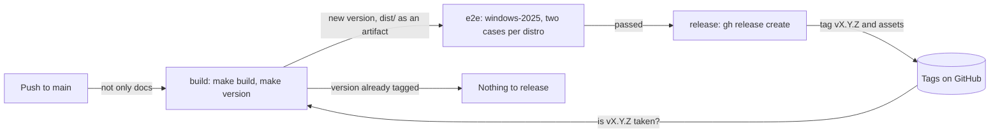

# Releases

How [`.github/workflows/release.yml`](../.github/workflows/release.yml) releases the config from `main`: how the version is decided and when a release is due, the end-to-end tests on Windows runners and the tags and assets it publishes. It's for engineers changing the workflow or the end-to-end scripts in [`.github/scripts/`](../.github/scripts/), and for anyone bumping the version.

## Contents

1. [Overview](#overview)
1. [How the version is decided](#how-the-version-is-decided)
1. [Tags and assets](#tags-and-assets)
1. [End-to-end tests](#end-to-end-tests)
1. [Security](#security)
1. [Decisions](#decisions)
1. [Limits](#limits)
1. [Sources](#sources)

## Overview

The workflow runs on every push to `main`, with the same `paths` filter as [CI](ci.md#overview), so a docs-only push runs nothing. Runs share the `release` concurrency group: a run waits for the one in progress, and a newer push replaces a run that's still waiting, so two releases never race. The `release` job only publishes from the newest run of the workflow, because a newer run releases the same changes. A docs-only push starts no run, so it doesn't hold a release back. This flowchart shows the jobs:

- **`build`** sets up the tools as the CI `checks` job does and runs `make build`. It lists the distros in `dist/` for the `e2e` matrix, then reads the version with `make version`. It asks GitHub's API for a tag named `v<version>`. When there's none, a release is due, and it uploads `dist/` as the `dist` artifact. When there's one, it outputs no version, and the later jobs are skipped.
- **`e2e`** runs only when a release is due. See [End-to-end tests](#end-to-end-tests).
- **`release`** needs both, so a failed build or end-to-end test skips it. It checks it's the newest run with `gh run list`, then downloads the artifact and runs `gh release create "v$VERSION" dist/* --target "$GITHUB_SHA" --generate-notes`, adding `--prerelease` when the version has a pre-release part.

## How the version is decided

The version is the `version` field in the manifests in [`src/manifests/`](../src/manifests/), such as `0.0.1`. Every distro is released together, under one tag, so every manifest has the same version. `make version` reads it from every manifest with jq, and prints it, or fails when the manifests' versions differ. CI runs it on every PR, so the versions can't drift apart.

Bump the version in the pull request (PR) that changes what `make build` writes to `dist/`. That's usually a change to a fragment a manifest lists, or to the fragments a manifest lists. A change that leaves `dist/` as it was, such as one to docs, CI or the end-to-end scripts, doesn't bump it. A change to the tooling bumps it only when it changes what's built. Without a bump, the release workflow releases nothing, so the change doesn't reach users until a later PR bumps the version. The exception is a version that hasn't been released yet, such as after a failed end-to-end test: a later change goes out under it without another bump. The code review checks the bump, as [`REVIEW.md`](../REVIEW.md) says.

Which part to bump depends on the version the manifests have now:

| Version now | A breaking change | A new feature | Anything else |
| --- | --- | --- | --- |
| `0.0.x` (alpha) | Patch | Patch | Patch |
| `0.x.y`, from `0.1.0` (beta) | Minor | Minor | Patch |
| From `1.0.0` | Major | Minor | Patch |

- A **breaking change** makes users change their meta-data or how they install, or stops setting up something an instance used to get. Mark it with `!` in the PR's title.
- A **new feature** sets up something new, or reads a new meta-data key.
- **Anything else** is a fix, a refactor or a package change that alters the built user-data.
- The first release is `v0.0.1`. The maintainer decides when to move to `0.1.0` and to `1.0.0`.
- A version with a pre-release part, such as `0.1.0-rc.1`, is published as a pre-release.

## Tags and assets

- GitHub creates the tag `vX.Y.Z` on the commit the run built, through `gh release create --target`. The release notes are GitHub's generated notes.
- The assets are the files in `dist/`: a `<distro>.user-data` for each manifest in `src/manifests/`, named after the manifest's file, today only `Ubuntu-26.04.user-data`. The README downloads one from `https://github.com/froazin/wsl/releases/latest/download/<distro>.user-data`, which skips pre-releases.
- No meta-data is released. Users write their own from the README's [meta-data example](../README.md#the-meta-data-example).
- The user-data's parts are base64 in the MIME file, so the README sends readers to the manifest and the fragments in `src/` at the release's tag to read them.

## End-to-end tests

The `e2e` job installs an instance the way the README tells users to, on a raw `windows-2025` runner, which comes with WSL, with the files the `build` job made. It runs under WSL's default settings, with no `.wslconfig`, because the README's `.wslconfig` is an optional example. It runs two cases for each distro the build made a user-data for, each on its own runner, because WSL instances on one machine share a cgroup tree. The `build` job lists the distros from `dist/` as a JSON list, which the matrix reads with `fromJSON`, so a new distro is tested without a change to the workflow:

| Case | Meta-data |
| --- | --- |
| `with a user` | The README's example with `username`, `git_name` and `git_email` filled in |
| `without a user` | The README's example as it is, with no username |

Each step is a script in `.github/scripts/`:

1. **`seed-cloud-init.ps1`** copies the distro's user-data to `%USERPROFILE%\.cloud-init\<distro>.user-data`, and writes the README's meta-data example there with the case's values filled into its empty keys. It finds the example by the `<!-- meta-data example -->` comment before it, and fails when the comment, the block or an empty key the case fills in is missing. [WSL meta-data](meta-data.md#overview) says what the example must keep.
1. **`install-instance.ps1`** runs `wsl --install <distro> --no-launch --web-download`.
1. **`wait-for-cloud-init.ps1`** runs `cloud-init status --wait` as root, which boots the instance for the first time, then shows cloud-init's status and logs. It fails if cloud-init didn't use the WSL datasource, or reports any error or recoverable error. A recoverable error that every instance gets, listed in `$expected`, is only logged.
1. **`restart-instance.ps1`** runs `wsl --terminate`, as the README says to, then fails unless `systemctl is-system-running --wait` says `running`.
1. **`check-instance.ps1`** runs [`check-instance.sh`](../.github/scripts/check-instance.sh) as root inside the instance. It checks the system files, packages, links, units, shells and dotfiles, and for the `with a user` case the user, their groups, git config, tools and gh extension. WSL attaches swap by default, so its `swap is off` check tests `disable-swap.service`.

`runcmd` doesn't stop at a failing entry, and cloud-init only sees the exit status of the last one, so `check-instance.sh` is what catches a failed install.

## Security

- **One job can write.** The workflow's token can only read, except in `release`, which has `contents: write`. `release` has no checkout and runs no repository code: it publishes the files the `build` job made and the end-to-end tests passed.
- **No credentials on disk.** Every checkout sets `persist-credentials: false`. `build` gives `gh` the read-only workflow token to look up the tag.
- **Pinned actions.** Every action is pinned to a full commit SHA, with its version in a comment.

## Decisions

- **The version in the manifest, bumped by hand.** The version sits next to the fragments it describes, the PR that changes them sets it and the code review checks it. Nothing has to read the commit history, so the `build` job needs no tags or history. It replaces python-semantic-release, which went with the old build.
- **A tag per version, not a comparison of files.** A release is due when no tag has the manifests' version, so a change that doesn't bump the version makes no release, whatever it changes. That's cheaper than downloading and comparing the latest release's files, and the version says what changed.
- **End-to-end tests before a release, not on each PR.** They take a long time on Windows runners, and only what's released reaches users.
- **A raw runner, not a setup action.** The `e2e` job installs the instance with `wsl.exe` as a user would, so it tests the README's steps rather than an action's.
- **The README's example, filled in.** The `e2e` job fills in the meta-data example users copy rather than using a fixture, so its defaults, such as the gh extension, are tested too.
- **Fail on recoverable errors.** A deprecated key or a schema warning means user-data that needs fixing. The exception is the network wait that every instance gets, which [Provisioning](provisioning.md#limits) explains. It's logged rather than annotated, so the run's annotations only show something to act on.
- **The tag from GitHub's API.** The `release` job needs no checkout or Git credentials to create it.

## Limits

- Only the code review checks that a change bumps the version, and that the bump is the right part. A missed bump means the change isn't released until a later one.
- Nothing checks that a new version is higher than the last. GitHub marks a new release as the latest by default (inferred from the API's `make_latest`), so a lower version would become the README's download.
- The tag GitHub creates isn't signed by a maintainer's key.
- A newer run that's cancelled by hand, rather than replaced by a newer push, takes its release with it. Re-run it to release.
- A failed end-to-end test on `main` blocks the release of that version. A fix that lands on `main` without another bump is then released under it.
- The user-data's parts are base64, so a release's user-data can't be read or diffed as text.
- A change to the end-to-end scripts, or to the README's meta-data example, isn't tested on a first boot until the next release.
- The end-to-end tests run a command as root for the first boot, which skips Ubuntu's first-run setup. That setup writes the default user to `/etc/wsl.conf`, so it isn't tested.
- VS Code and the other Windows tools aren't on the runner, so their links are checked but the VS Code extension installs are skipped. Mirrored networking isn't tested.
- The end-to-end tests download Ubuntu and every package on each run, so they take a while and depend on those servers.

## Sources

- https://cli.github.com/manual/gh_release_create
- https://docs.github.com/en/rest/git/refs#list-matching-references
- https://docs.github.com/en/rest/releases/releases#create-a-release
- https://docs.github.com/en/repositories/releasing-projects-on-github/linking-to-releases
- https://learn.microsoft.com/en-us/windows/wsl/basic-commands
- https://cloudinit.readthedocs.io/en/latest/reference/cli.html#status
- https://github.com/actions/runner-images/blob/main/images/windows/Windows2025-Readme.md
