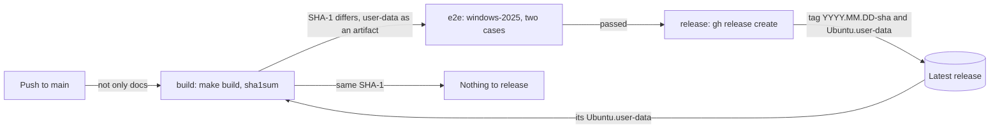

# Releases

How [`.github/workflows/release.yml`](../.github/workflows/release.yml) releases the user-data from `main`: when a release is due, the end-to-end tests on Windows runners and the tag and asset it publishes. It's for engineers changing the workflow or the end-to-end scripts in [`.github/scripts/`](../.github/scripts/).

## Contents

1. [Overview](#overview)
1. [When a release is due](#when-a-release-is-due)
1. [Tags and assets](#tags-and-assets)
1. [End-to-end tests](#end-to-end-tests)
1. [Security](#security)
1. [Decisions](#decisions)
1. [Limits](#limits)
1. [Sources](#sources)

## Overview

The workflow runs on every push to `main`, with the same `paths` filter as [CI](ci.md#overview), so a docs-only push runs nothing. Runs share the `release` concurrency group: a run waits for the one in progress, and a newer push replaces a run that's still waiting, so two releases never race. The `release` job only publishes from the newest run of the workflow, because a newer run releases the same changes. A docs-only push starts no run, so it doesn't hold a release back. This flowchart shows the jobs:

- **`build`** sets up the tools as the CI `checks` job does and runs `make build`. It then compares the user-data with the latest release's, as [When a release is due](#when-a-release-is-due) describes. When a release is due, it outputs the tag and uploads `dist/Ubuntu.user-data` as the `dist` artifact. Otherwise it outputs no tag, and the later jobs are skipped.
- **`e2e`** runs only when a release is due. See [End-to-end tests](#end-to-end-tests).
- **`release`** needs both, so a failed build or end-to-end test skips it. It checks it's the newest run with `gh run list`, then downloads the artifact and runs `gh release create "$TAG" dist/Ubuntu.user-data --target "$GITHUB_SHA" --generate-notes`.

## When a release is due

The project has no version to bump. A release is due when the user-data changes:

1. The build is reproducible: it replaces make-mime's random MIME boundary with a fixed one, as [Build](build.md#how-the-build-works) describes, so the same fragments build the same file with the same cloud-init.
1. The `build` job takes the SHA-1 of `dist/Ubuntu.user-data` with `sha1sum`.
1. When a release exists, it downloads the latest release's `Ubuntu.user-data` with `gh release download`, and takes its SHA-1 the same way. Before the first release, there's nothing to compare with.
1. When the two SHA-1s match, nothing has changed for users, and there's nothing to release. Otherwise a release is due.

So any change to a fragment, or a change to the `Makefile` that changes its output, makes a release, and any other change, such as to CI, the end-to-end scripts or the README, makes none. That holds while the latest release has the current user-data: after a release that didn't go out, such as after a failed end-to-end test, any later push that changes more than docs tries again. Nobody has to decide whether a change makes a release. Any failure to read the latest release fails the job, so a release is never made because it couldn't be read.

## Tags and assets

- The tag is the commit's date in UTC and its short SHA, such as `2026.11.10-0783a85`, so tags sort by date and name the commit they came from. GitHub creates it on the commit the run built, through `gh release create --target`. The release notes are GitHub's generated notes.
- The only asset is `Ubuntu.user-data`. The README downloads it from `https://github.com/froazin/wsl/releases/latest/download/Ubuntu.user-data`.
- No meta-data is released. Users write their own from the README's [meta-data example](../README.md#the-meta-data-example).
- The user-data's parts are base64 in the MIME file, so the README sends readers to the fragments in `src/fragments/` at the release's tag to read them.

## End-to-end tests

The `e2e` job installs an instance the way the README tells users to, `wsl --install Ubuntu`, on a raw `windows-2025` runner, which comes with WSL, with the user-data the `build` job made. It runs under WSL's default settings, with no `.wslconfig`, because the README's `.wslconfig` is an optional example. It runs two cases, each on its own runner, because WSL instances on one machine share a cgroup tree:

| Case | Meta-data |
| --- | --- |
| `with a user` | The README's example with `username`, `git_name` and `git_email` filled in |
| `without a user` | The README's example as it is, with no username |

Each step is a script in `.github/scripts/`:

1. **`seed-cloud-init.ps1`** copies the user-data to `%USERPROFILE%\.cloud-init\Ubuntu.user-data`, and writes the README's meta-data example there as `Ubuntu.meta-data`, with the case's values filled into its empty keys. It finds the example by the `<!-- meta-data example -->` comment before it, and fails when the comment, the block or an empty key the case fills in is missing. [WSL meta-data](meta-data.md#overview) says what the example must keep.
1. **`install-instance.ps1`** runs `wsl --install Ubuntu --no-launch --web-download`.
1. **`wait-for-cloud-init.ps1`** runs `cloud-init status --wait` as root, which boots the instance for the first time, then shows cloud-init's status and logs. It fails if cloud-init didn't use the WSL datasource, or reports any error or recoverable error. A recoverable error that every instance gets, listed in `$expected`, is only logged.
1. **`restart-instance.ps1`** runs `wsl --terminate`, as the README says to, then fails unless `systemctl is-system-running --wait` says `running`.
1. **`check-instance.ps1`** runs [`check-instance.sh`](../.github/scripts/check-instance.sh) as root inside the instance. It checks the system files, packages, links, units, shells and dotfiles, and for the `with a user` case the user, their groups, git config, tools and gh extension. WSL attaches swap by default, so its `swap is off` check tests `disable-swap.service`.

`runcmd` doesn't stop at a failing entry, and cloud-init only sees the exit status of the last one, so `check-instance.sh` is what catches a failed install.

## Security

- **One job can write.** The workflow's token can only read, except in `release`, which has `contents: write`. `release` has no checkout and runs no repository code: it publishes the user-data the `build` job made and the end-to-end tests passed.
- **No credentials on disk.** Every checkout sets `persist-credentials: false`. `build` gives `gh` the read-only workflow token to read the latest release.
- **Pinned actions.** Every action is pinned to a full commit SHA, with its version in a comment.

## Decisions

- **The user-data's hash, not a version.** A release is due exactly when what users download changes, so nobody bumps a version, and the code review has no bump to check. A change to the `Makefile` that builds the same file makes no release.
- **SHA-1 with `sha1sum`.** It only has to tell two builds apart, not resist an attacker, and `sha1sum` is on every runner.
- **A tag from the date and commit.** It sorts by date, names the commit and needs no state to work out.
- **End-to-end tests before a release, not on each pull request.** They take a long time on Windows runners, and only what's released reaches users.
- **A raw runner, not a setup action.** The `e2e` job installs the instance with `wsl.exe` as a user would, so it tests the README's steps rather than an action's.
- **The README's example, filled in.** The `e2e` job fills in the meta-data example users copy rather than using a fixture, so its defaults, such as the gh extension, are tested too.
- **Fail on recoverable errors.** A deprecated key or a schema warning means user-data that needs fixing. The exception is the network wait that every instance gets, which [Provisioning](provisioning.md#limits) explains. It's logged rather than annotated, so the run's annotations only show something to act on.
- **The tag from GitHub's API.** The `release` job needs no checkout or Git credentials to create it.

## Limits

- The tests install whatever release of Ubuntu the Store's `Ubuntu` is, so they move to a new release of Ubuntu when the Store does, without a change here.
- A new cloud-init on the runner that changes make-mime's output, but not the fragments, makes a release.
- The tag GitHub creates isn't signed by a maintainer's key.
- A newer run that's cancelled by hand, rather than replaced by a newer push, takes its release with it. Re-run it to release.
- A failed end-to-end test on `main` blocks the release. The next push that changes more than docs still builds a user-data that differs from the latest release, so it runs the tests again, and releases when they pass.
- The user-data's parts are base64, so a release's user-data can't be read or diffed as text.
- A change to the end-to-end scripts, or to the README's meta-data example, isn't tested on a first boot until the next release.
- The end-to-end tests run a command as root for the first boot, which skips Ubuntu's first-run setup. That setup writes the default user to `/etc/wsl.conf`, so it isn't tested.
- VS Code and the other Windows tools aren't on the runner, so their links are checked but the VS Code extension installs are skipped. Mirrored networking isn't tested.
- The end-to-end tests download Ubuntu and every package on each run, so they take a while and depend on those servers.

## Sources

- https://cli.github.com/manual/gh_release_create
- https://cli.github.com/manual/gh_release_download
- https://docs.github.com/en/repositories/releasing-projects-on-github/linking-to-releases
- https://learn.microsoft.com/en-us/windows/wsl/basic-commands
- https://cloudinit.readthedocs.io/en/latest/reference/cli.html#status
- https://github.com/actions/runner-images/blob/main/images/windows/Windows2025-Readme.md
