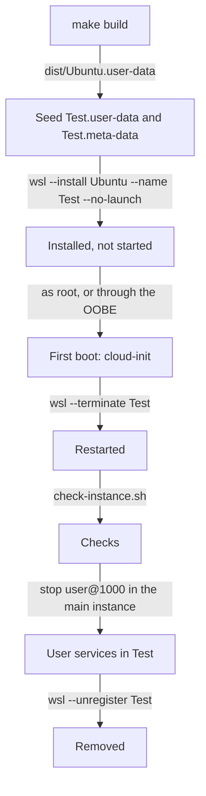

# Testing

How to test a change to the user-data on a throwaway WSL instance, beside the instance you work in, and what the two share. It's for engineers changing [`src/`](../src/). The checks that run without an instance are in the README's [Building it](../README.md#building-it), and the release's own end-to-end test is in [Releases](releases.md#end-to-end-tests).

## Contents

1. [Overview](#overview)
1. [Seeding the instance](#seeding-the-instance)
1. [First boot](#first-boot)
1. [Checks](#checks)
1. [Running beside another instance](#running-beside-another-instance)
1. [Cleaning up](#cleaning-up)
1. [Limits](#limits)
1. [Sources](#sources)

## Overview

`make build` and `make lint` check each fragment on its own. Only a first boot exercises the WSL datasource, the merged parts, the package installs, the installers and Ubuntu's out-of-box experience (OOBE). This flowchart shows a test run, from PowerShell or from a WSL shell through `wsl.exe`:



## Seeding the instance

1. Run `make build`, then copy `dist/Ubuntu.user-data` to `%USERPROFILE%\.cloud-init\Test.user-data`.
1. Write `%USERPROFILE%\.cloud-init\Test.meta-data` from the README's [meta-data example](../README.md#the-meta-data-example). Fill in your own values to test what you use, such as commit signing and your VS Code extensions, or leave `username` empty to test `wsluser`.
1. Install the instance without starting it, so the next command is its first boot:

   ```powershell
   wsl --install Ubuntu --name Test --no-launch
   ```

Always give the instance its own `<name>.user-data`. When it has none, the datasource falls back to `<ID>-<VERSION_ID>.user-data`, such as `Ubuntu-26.04.user-data`, then `Ubuntu-all.user-data` and `default.user-data`, so a file left for another instance quietly provisions the test one (observed). To get a clean Ubuntu baseline, seed it with a user-data that does nothing:

```yaml
#cloud-config
final_message: "baseline, no config"
```

## First boot

There are two ways to boot it, and they test different things:

| Command | Runs the OOBE | Tests |
| --- | --- | --- |
| `wsl -d Test -u root -e cloud-init status --wait` | No | What the release's end-to-end test runs. The default user stays root |
| `wsl -d Test`, with no command | Yes | What users get. `wsl-setup` waits for cloud-init, finds the user with uid 1000 and writes `[user] default=` to `/etc/wsl.conf` |

- A launch as the default user with a command, such as `wsl -d Test -e sh -c ...`, runs as root and skips the OOBE (observed).
- The OOBE's Ubuntu Insights prompt is skipped when stdin isn't a terminal, so `"exit" | wsl -d Test` runs it without stopping (observed).
- cloud-init takes about three minutes with a fast connection (observed). `cloud-init status --long` should list only the masked network wait as a recoverable error, as [Provisioning](provisioning.md#limits) explains.
- Then restart it as the README says, with `wsl --terminate Test`, and check `systemctl is-system-running --wait` says `running`.

## Checks

Run the release's check script as root inside the instance, from the repository's root, with the username and git name from the meta-data:

```sh
wsl.exe -d Test -u root -e sh -s -- <username> "<git name>" < .github/scripts/check-instance.sh
```

It reads the script from stdin, so it works from a clone on the Linux file system, which the instance can't see. Beyond its checks, try what you changed for real, such as:

- `podman run` and `podman compose up` as the user, which need the user session (see below).
- `node` and `npm` in an interactive `zsh`, which is where the dotfiles load nvm.
- A VM's network device: `qemu-system-x86_64 -M q35 -accel kvm -display none -device virtio-net-pci` fails at once when its ROM is missing.

## Running beside another instance

Every WSL 2 instance runs in one virtual machine (VM), so instances share its kernel, cgroup tree and network namespace. A test instance built from this config clashes with a main instance built from it:

| Shared | What happens | Recovery |
| --- | --- | --- |
| cgroup tree | The second instance's `user@1000.service` fails with "Failed to spawn executor: Device or resource busy", so WSL reports "Failed to start the systemd user session" and the user's `podman.socket` doesn't start. When it did start, stopping it timed out with "Processes still around after final SIGKILL", from the other instance's processes | Hand the session over, as below |
| cgroup tree | `getty@tty1.service` fails with "Failed to spawn executor: No such file or directory" in one instance when the other's starts, which leaves it `degraded`. It hit the main instance when the test instance booted, and the test instance when the main one's was restarted | In the failed instance: `sudo systemctl reset-failed getty@tty1.service`, then `sudo systemctl restart getty@tty1.service` |
| Network namespace | The second instance's libvirt `default` network doesn't start: dnsmasq reports "failed to create listening socket ... Address already in use". The same happens to any socket both bind, such as `iscsid.socket`'s abstract socket when `open-iscsi` is installed | Expected. Each network works while only one instance runs it |
| `binfmt_misc` table | Stopping or removing another instance sometimes clears every entry, `WSLInterop` included, so `wsl.exe`, `code` and every other Windows program fail with "exec format error" in all running instances | `sudo systemctl restart systemd-binfmt.service` in each instance, from a shell that's already open, or `wsl -d <name> -u root systemctl restart systemd-binfmt.service` from PowerShell |

The `binfmt_misc` clear comes from the stopping instance's last shutdown step. In one terminate watched every 10 ms, the table emptied 9 ms after the test instance's `systemd-shutdown` stopped its journal, 3.3 seconds after `wsl --terminate` (observed). `systemd-shutdown` has a `disable_binfmt` step, which writes to the table every instance shares (inferred). It cleared the table on six of the stops of instances built from this config, and after `wsl --unregister`, but in none of ten terminates of a clean Ubuntu instance, with or without `finalrd` (observed). What decides it isn't known. Check `ls /proc/sys/fs/binfmt_misc` after every terminate or unregister while you test.

The instances share one kernel boot ID, so `journalctl -b` in either shows both instances' boots. Use timestamps, such as `journalctl --since`, to line them up.

### Handing over the user session

To test the user's services, such as rootless podman, move uid 1000's user manager to the test instance and back. The main instance keeps running. Its shells and VS Code's server run outside `user@1000.service`, so they carry on (observed):

1. In the main instance: `sudo systemctl stop user@1000.service`.
1. In the test instance, as root: `systemctl reset-failed user@1000.service`, then `systemctl start user@1000.service`.
1. Test, such as with `systemctl --user -M <username>@ is-active podman.socket` and `podman run` as the user.
1. In the test instance: `systemctl stop user@1000.service`.
1. In the main instance: `sudo systemctl start user@1000.service`, and check `systemctl --user is-active podman.socket`.

## Cleaning up

```powershell
wsl --unregister Test
Remove-Item "$env:USERPROFILE\.cloud-init\Test.*"
```

Check the `binfmt_misc` table in the instances you keep afterwards, as [Running beside another instance](#running-beside-another-instance) describes.

## Limits

- `runuser -l <user>` sets no locale, so zsh started that way prints `character not in range` from the prompt, and `can't change option: zle` without a terminal. A real login doesn't (observed).
- `gh extension list` needs a login. Look in `~/.local/share/gh/extensions` instead.
- Windows programs run from the test instance, such as VS Code installing extensions, act on the same Windows profile as the main instance.

## Sources

- https://cloudinit.readthedocs.io/en/latest/reference/datasources/wsl.html
- https://learn.microsoft.com/en-us/windows/wsl/basic-commands
- https://learn.microsoft.com/en-us/windows/wsl/wsl-config
- https://docs.kernel.org/admin-guide/binfmt-misc.html
